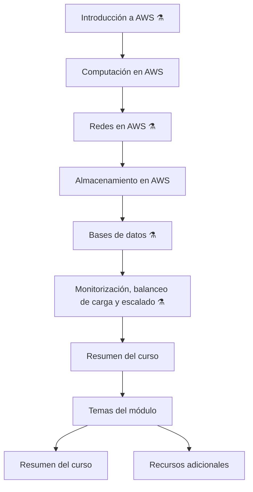

# Módulo 0: Descripción general del curso

<!-- markdownlint-disable MD033 -->

  
  

<!-- markdownlint-enable MD033 -->

## Mapa del curso

### [Módulo 1: Introducción a Amazon Web Services](modulos/01-introduccion-a-amazon-web-services.md)

Este módulo presenta:

- [Los conceptos fundamentales de la nube.](modulos/01-introduccion-a-amazon-web-services.md#que-es-la-computacion-en-la-nube)
- [Las ventajas de utilizar servicios en la nube.](modulos/01-introduccion-a-amazon-web-services.md#ventajas-de-la-computacion-en-la-nube)
- [La infraestructura global de AWS.](modulos/01-introduccion-a-amazon-web-services.md#aws-global-infrastructure)
- [AWS Identity and Access Management (IAM).](modulos/01-introduccion-a-amazon-web-services.md#aws-identity-and-access-management-iam)

---

### [Módulo 2: Computación en AWS](modulos/02-computacion-en-aws.md)

Este módulo presenta los principales servicios de computación de AWS:

- [Amazon Elastic Compute Cloud (Amazon EC2).](modulos/02-computacion-en-aws.md#amazon-elastic-compute-cloud)
- [AWS Lambda.](modulos/02-computacion-en-aws.md#aws-lambda)
- [Amazon Elastic Container Service (Amazon ECS).](modulos/02-computacion-en-aws.md#amazon-elastic-container-service)
- [Amazon Elastic Kubernetes Service (Amazon EKS).](modulos/02-computacion-en-aws.md#amazon-elastic-kubernetes-service)

El módulo explica distintas formas de ejecutar aplicaciones y cargas de trabajo en AWS, desde instancias virtuales hasta contenedores y funciones sin servidor.

---

### [Módulo 3: Redes en AWS](modulos/03-redes-en-aws.md)

Este módulo se centra en Amazon Virtual Private Cloud (Amazon VPC).
También aborda otras tecnologías de red utilizadas para:

- [Crear redes privadas en AWS.](modulos/03-redes-en-aws.md#amazon-virtual-private-cloud-amazon-vpc)
- [Proteger los recursos.](modulos/03-redes-en-aws.md#listas-de-control-de-acceso-de-red-y-grupos-de-seguridad)
- [Controlar la comunicación entre componentes.](modulos/03-redes-en-aws.md#tablas-de-rutas)
- [Conectar una red privada con los recursos de AWS.](modulos/03-redes-en-aws.md#virtual-private-network-vpn)

---

### [Módulo 4: Almacenamiento en AWS](modulos/04-almacenamiento-en-aws.md)

Este módulo presenta diferentes soluciones de almacenamiento:

- [Amazon Simple Storage Service (Amazon S3).](modulos/04-almacenamiento-en-aws.md#almacenamiento-de-objetos)
- [Amazon Elastic Block Store (Amazon EBS).](modulos/04-almacenamiento-en-aws.md#almacenamiento-en-bloques)
- [Amazon Elastic File System (Amazon EFS).](modulos/04-almacenamiento-en-aws.md#amazon-elastic-file-system)
- [Amazon FSx.](modulos/04-almacenamiento-en-aws.md#amazon-fsx)
- [Almacenamiento de instancias de Amazon EC2.](modulos/04-almacenamiento-en-aws.md#almacenamiento-de-archivos)

El módulo explica cómo seleccionar una solución de almacenamiento según las necesidades de la aplicación.

---

### [Módulo 5: Bases de datos](modulos/05-bases-de-datos.md)

Este módulo presenta varios casos de uso relacionados con servicios de base de datos, con especial atención a:

- [Amazon Relational Database Service (Amazon RDS).](modulos/05-bases-de-datos.md#amazon-relational-database-service)
- [Amazon DynamoDB.](modulos/05-bases-de-datos.md#amazon-dynamodb)

---

### [Módulo 6: Monitorización, balanceo de carga y escalado](modulos/06-monitorizacion-balanceo-de-carga-y-escalado.md)

Este módulo explica cómo monitorizar y escalar aplicaciones mediante:

- [Amazon CloudWatch.](modulos/06-monitorizacion-balanceo-de-carga-y-escalado.md#amazon-cloudwatch)
- [Elastic Load Balancing (ELB).](modulos/06-monitorizacion-balanceo-de-carga-y-escalado.md#elastic-load-balancing)
- [Amazon EC2 Auto Scaling.](modulos/06-monitorizacion-balanceo-de-carga-y-escalado.md#amazon-ec2-auto-scaling)

Estos servicios permiten observar el comportamiento de las aplicaciones, distribuir el tráfico y adaptar la capacidad según la demanda.

---

### Módulo 7: Resumen del curso

El último módulo resume los principales conceptos tratados durante el curso, especialmente:

- Los servicios fundamentales de AWS.
- La relación entre computación, redes y almacenamiento.
- Las bases de datos.
- La monitorización.
- El balanceo de carga.
- El escalado.

*Los módulos que contienen este símbolo ⚗️ disponen de laboratorio práctico.*

---

!!! info "Acerca de este proyecto"
    - Esta documentación ha sido elaborada de forma independiente por **José Antonio Seguido Doblado** como material de estudio.
    - No constituye documentación oficial de Amazon Web Services (AWS).
