# Módulo 2: Computación en AWS

<!-- markdownlint-disable MD033 -->

  
  

<!-- markdownlint-enable MD033 -->

## Objetivos

En este módulo explorarás:

- Los conceptos fundamentales de Amazon Elastic Compute Cloud (Amazon EC2).
- Amazon Elastic Container Service (Amazon ECS).
- Amazon Elastic Kubernetes Service (Amazon EKS).
- AWS Fargate.
- AWS Lambda.

---

## Computación como servicio en AWS

AWS ofrece diferentes formas de proporcionar capacidad de computación según las necesidades de una aplicación.
Estas opciones incluyen:

- Instancias virtuales.
- Contenedores.
- Ejecución de código sin administrar servidores.
- Servicios administrados para ejecutar cargas de trabajo.

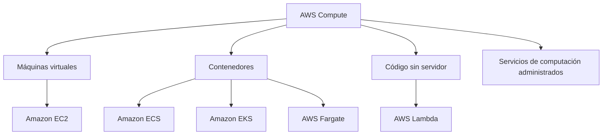

---

## Amazon Elastic Compute Cloud

### Amazon EC2

Amazon Elastic Compute Cloud, o **Amazon EC2**, proporciona capacidad de computación segura y redimensionable en la nube.
Con Amazon EC2 puedes:

- Aprovisionar capacidad informática.
- Lanzar instancias en cuestión de minutos.
- Escalar la capacidad según las necesidades.
- Pagar por la capacidad utilizada por hora o por segundo.

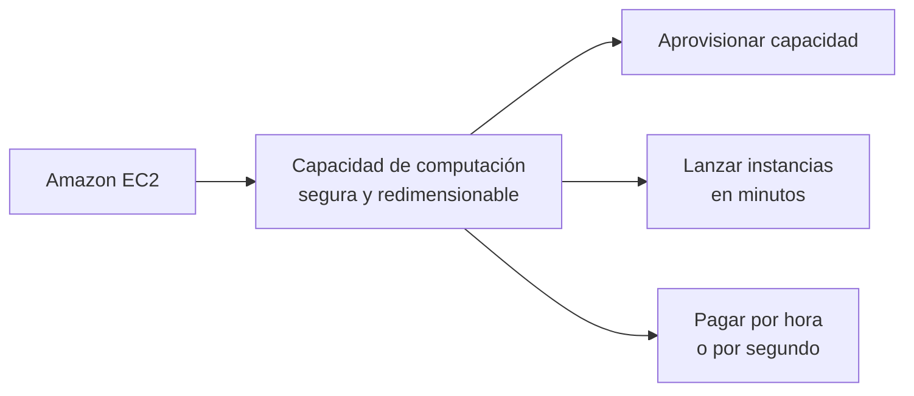

Una instancia de EC2 es un servidor virtual que se ejecuta en AWS.

---

### Amazon Machine Image

Antes de lanzar una instancia de EC2, debes especificar una **Amazon Machine Image (AMI)**.
Una AMI contiene la información necesaria par lanzar una instancia, entre ella:

- Sistema operativo.
- Mapeos de almacenamiento.
- Tipo de arquitectura.
- Permisos de lanzamiento.
- Aplicaciones de software preinstaladas.

Cuando se lanza una instancia, la AMI se copia en el volumen raíz de la instancia.
Una misma AMI puede utilizarse para lanzar varias instancias de EC2 con la misma configuración.

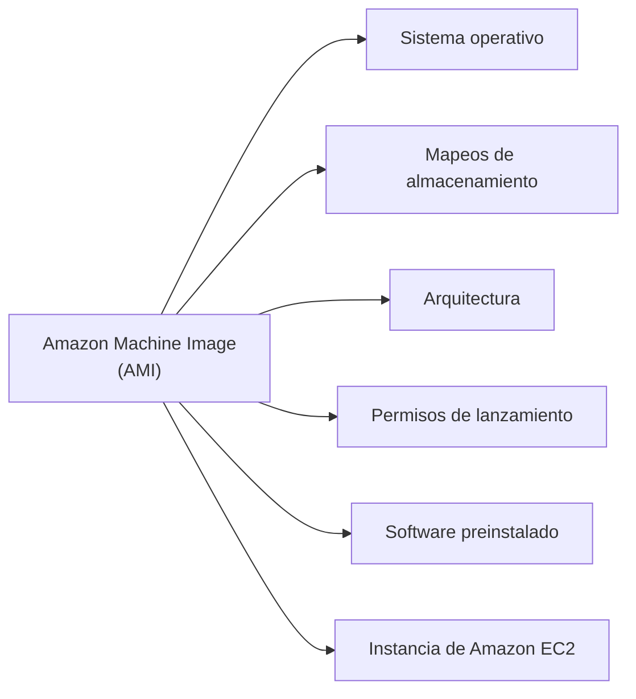

AWS admite distintos sistemas operativos, entre ellos:

- Linux.
- macOs.
- Windows.
- Otros sistemas operativos compatibles.

Con las AMI puedes:

- Crear tus propias imágenes.
- Utilizar las AMI disponibles en AWS.
- Comprar AMI desde AWS Marketplace.

---

### Tipos y tamaños de instancia

Las instancias de EC2 se definen mediante un tipo y un tamaño de instancia.

#### Tipo de instancia

El tipo de instancia identifica la categoría de hardware de la instancia.
Puede indicar, entre otros aspectos:

- El equilibrio entre recursos de computación, memoria y red.
- El tipo de procesador.
- La familia de instancia.
- La arquitectura utilizada.

#### Tamaño de instancia

El tamaño indica cuántos recursos tiene la instancia, como:

- Núcleos de unidad central de procesamiento virtual (vCPU).
- Memoria RAM.
- Ancho de banda de red.
- Almacenamiento de la instancia.

Por ejemplo, una instancia `m8g.4xlarge` representa:

- Familia `m` : propósito general.
- Generación `8` .
- Procesador `g` : Amazon Graviton.
- Tamaño `4xlarge` .

Una instancia de propósito general ofrece un equilibrio entre computación, memoria y recursos de red.
Estas instancias son adecuadas para:

- Servidores web.
- Repositorios de código.
- Bases de datos pequeñas y medianas.

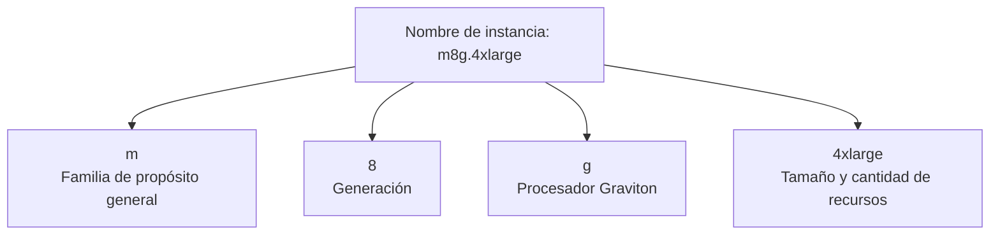

Este sistema permite separar:

- El tipo de computación que necesita una carga de trabajo.
- La cantidad de recursos necesarios.

Puedes comenzar con un tamaño pequeño y aumentar los recursos a medida que crece la carga de trabajo.

AWS Graviton son procesadores basados en ARM diseñadores por AWS para ofrecer una buena relación entre precio y rendimiento para cargas de trabajo en la nube.
El tamaño `4xlarge` indica aproximadamente cuatro veces los recursos de un tamaño `xlarge` .

---

### Selección de un tipo de instancia especializado

Las instancias de propósito general son adecuadas para muchas aplicaciones habituales. Sin embargo, AWS también ofrece familias especializadas para lograr un equilibrio entre precio y rendimiento según la carga de trabajo.

La clave para elegir el tipo de instancia adecuado consiste en identificar el cuello de botella de la carga de trabajo.
El cuello de botella es el recurso que limita el rendimiento de la aplicación.

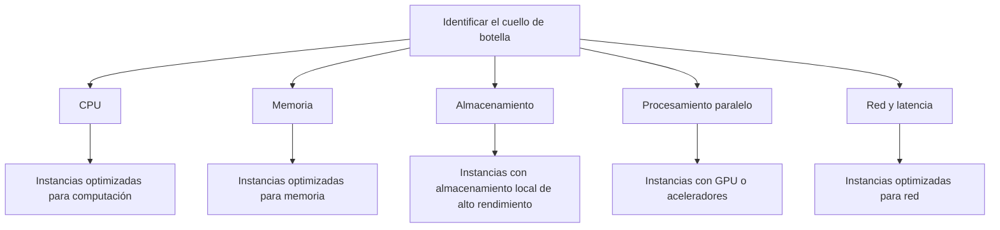

Alguna categorías especializadas incluyen:

- Instancias con muchos núcleos de CPU.
- Instancias con una proporción elevada de RAM respecto a vCPU.
- Instancias con almacenamiento local NVMe o discos densos.
- Instancias con GPU.
- Instancias con FPGA.
- Instancias con redes de baja latencia y gran ancho de banda.

Estas instancias pueden utilizarse para cargas de trabajo como:

- Procesamiento de datos.
- Bases de datos en memoria.
- Almacenes de datos.
- Aprendizaje automático e inteligencia artificial.
- Transcodificación.
- Modelos de gran tamaño.
- Predicción meteorológica.
- Computación paralela.

Si no sabes qué tipo de instancia elegir, comienza con una instancia de propósito general, analiza la carga de trabajo en condiciones reales y cambia a una familia especializada cuando identifiques un cuello de botella claro.

---

### Ciclo de vida de una instancia de Amazon EC2

Una instancia de EC2 atraviesa distintos estados desde el momento en que se crea hasta que se termina.

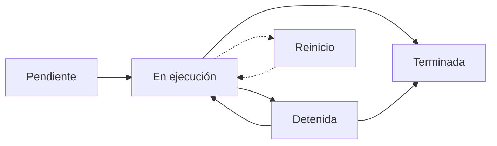

#### Estado pendiente

Cuando lanzas una instancia desde una AMI, o la inicias después de haberla detenido, pasa primero al estado **pendiente**.

En este estado:

- AWS prepara la instancia.
- La AMI se copia en el volumen raíz.
- Se asignan los componentes de red necesarios.
- No se realiza ningún cargo por la instancia en ejecución.

#### Estado en ejecución

Cuando termina la preparación, la instancia pasa al estado **en ejecución**.
En este estado:

- La instancia está disponible para utilizarse.
- Puedes conectarte a ella.
- Se realiza el cobro correspondiente.

#### Reinicio

Puedes reiniciar una instancia en cualquier momento.
El reinicio mantiene la instancia y no la elimina.

#### Estado detenida

Cuando detienes una instancia, pasa al estado **detenida**.
En este estado:

- La instancia no puede utilizarse.
- Puedes volver a iniciarla posteriormente.
- No se realiza el cobro por la capacidad de computación de la instancia detenida.

Esto es similar a apagar un ordenador portátil.

#### Detención con hibernación

Cuando detienes una instancia mediante hibernación:

- La instancia pasa al estado detenida.
- Se conserva la información que estaba en memoria.
- El siguiente inicio puede ser más rápido.
- Puedes continuar desde el punto en el que detuviste la instancia.

#### Estado terminada

Cuando ya no necesites una instancia, puedes terminarla desde los estados **en ejecución** o **detenida**.
En el estado **terminada:**

- La instancia se elimina permanentemente.
- No puede volver a iniciarse.
- Se eliminan los datos almacenados en la instancia.
- Los datos guardados en almacenamiento externo no se eliminan necesariamente.

> [!NOTE] Nota  
> La terminación es diferente de la detención: una instancia detenida puede volver a iniciarse, mientras que una instancia terminada se elimina de forma permanente.

---

### Precios de Amazon EC2

Amazon EC2 ofrece diferentes modelos de compra y precios:

- **AWS Free Tier:** permite utilizar determinados recursos dentro de los límites establecidos.
- **On-Demand Instances:** pago por la capacidad utilizada, sin compromiso a largo plazo.
- **Saving Plans:** ofrecen precios reducidos a cambio de un compromiso de uso.
- **Dedicated Hosts:** servidores físicos dedicados para una cuenta.
- **Spot Instances:** permiten utilizar capacidad disponible de AWS a precios reducidos.

---

## Servicios de contenedores de AWS

### Máquinas virtuales y contenedores

Un contenedor es una unidad estandarizada que empaqueta el código de una aplicación y sus dependencias.
El contenedor puede ejecutarse en distintos sistemas operativos y máquinas, lo que ayuda a obtener:

- Un comportamiento predecible.
- Menos problemas de compatibilidad.
- Mantenimiento más eficiente.
- Despliegues más consistentes.

Un plataforma de contenerización es Docker Engine.
Docker es una plataforma de desarrollo de software que permite:

- Crear contenedores.
- Empaquetar aplicaciones.
- Desplegar aplicaciones.
- Ejecutar contenedores.

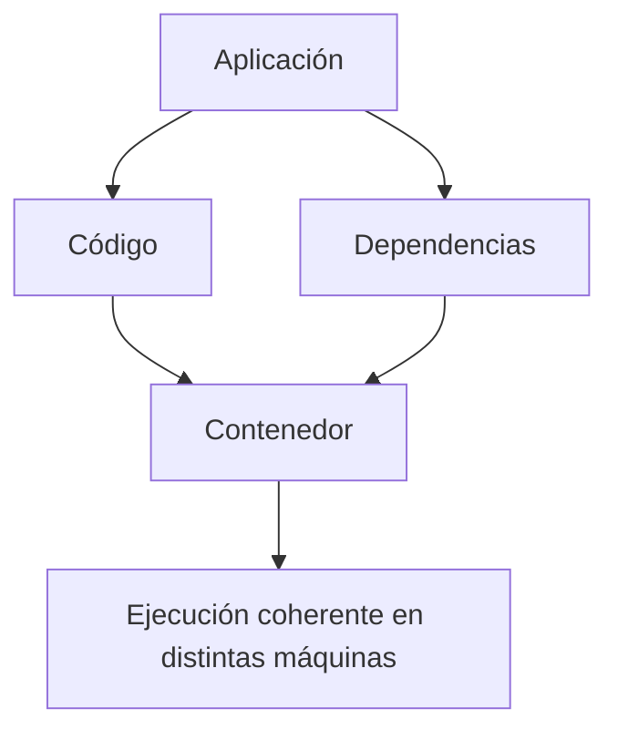

#### Contenedores frente a máquinas virtuales

Los contenedores:

- Comparten el sistema operativo y el kernel del host donde se despliegan.
- Tardan pocos segundos en iniciarse.
- Utilizan menos recursos que una máquina virtual completa.

Las máquinas virtuales utilizan un **hipervisor**, que es una plataforma de virtualización.
Existen dos tipos de hipervisores:

- **Tipo 1:** hipervisor nativo o bare-metal. Se ejecuta directamente sobre el servidor físico para controlar el hardware y los sistemas operativos invitados.
- **Tipo 2:** hipervisor alojado. Se ejecuta sobre un sistema operativo convencional.

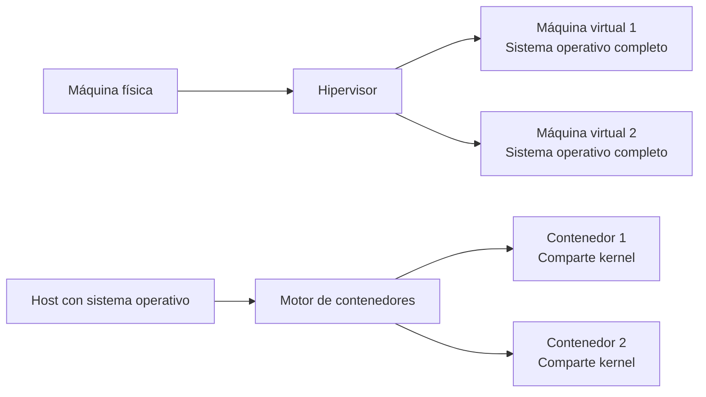

Cuando una organización gestiona pocos contenedores, puede administrarlos directamente. Sin embargo, a medida que aumenta el número de contenedores y se distribuyen en varias instancias EC2 y zonas de disponibilidad, la gestión se vuelve más compleja.

También se vuelve necesario gestionar:

- Los despliegues de contenedores.
- Los errores de los contenedores.
- Los errores de las instancias.
- La distribución entre las zonas de disponibilidad.

Para resolver este problema, AWS ofrece servicios de orquestación de contenedores.

---

## Servicios de orquestación de contenedores de AWS

AWS ofrece:

- Amazon Elastic Container Service (Amazon ECS).
- Amazon Elastic Kubernetes Service (Amazon EKS).

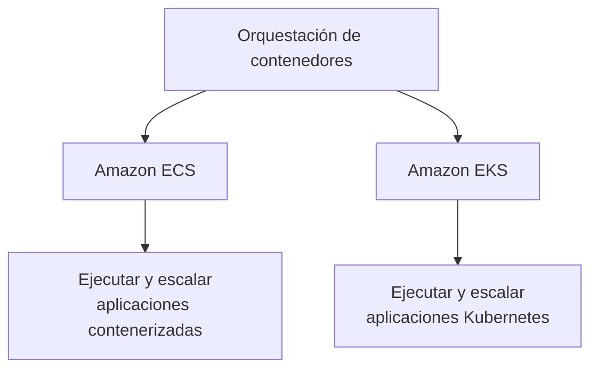

### Amazon ECS

**Amazon ECS** es un sistema de gestión de contenedores escalable y de alto rendimiento.
Amazon ECS ayuda a:

- Crear nuevos contenedores.
- Gestionar contenedores.
- Ejecutar contenedores en instancias EC2.
- Escalar aplicaciones contenerizadas.

Amazon ECS admite contenedores Docker.

Para administrar los contenedores, debes instalar un agente de contenedores de Amazon ECS en las instancias EC2.
Este agente convierte la instancia EC2 en una **instancia de contenedor**.
El agente puede ejecutarse en AMI de:

- Linux.
- Windows.

Amazon ECS utiliza llamadas a la API para controlar aplicaciones compatibles con Docker.

---

### Amazon EKS

**Amazon EKS** proporciona flexibilidad para iniciar, ejecutar y escalar aplicaciones Kubernetes:

- En AWS Cloud.
- En entornos locales.

Kubernetes es una plataforma de código abierto para gestionar aplicaciones contenerizadas.
Kubernetes es:

- Portable.
- Extensible.
- Adecuado para administrar aplicaciones contenerizadas.

Amazon EKS permite crear clústeres:

- Altamente disponibles.
- Seguros.
- Capaces de ejecutar cargas de trabajo Kubernetes.

Amazon EKS también automatiza:

- La aplicación de parches.
- El aprovisionamiento de nodos.
- Las actualizaciones.

---

## Computación sin servidor

La computación sin servidor permite ejecutar código o aplicaciones sin tener que aprovisionar ni administrar servidores directamente.

### Ventajas

Entre sus ventajas se incluyen:

- No es necesario aprovisionar ni administrar servidores.
- La capacidad escala según el caso.
- Solo se paga por los recursos utilizados.
- Incluye disponibilidad y tolerancia a errores integradas.
- Facilita la integración con otros servicios.

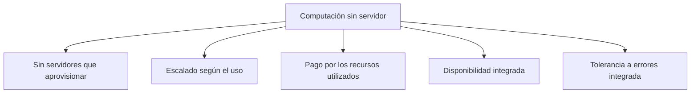

---

### AWS Lambda

**AWS Lambda** es un servicio de computación que permite ejecutar código sin aprovisionar ni administrar servidores.

Con AWS Lambda:

- Solo pagas por el tiempo de computación utilizado.
- No se cobra cuando el código no se está ejecutando.
- Puedes ejecutar código para distintos tipos de aplicaciones y servicios backend.
- AWS administra la infraestructura necesaria.
- AWS escala el código automáticamente.
- Las funciones pueden ejecutarse con alta disponibilidad.

Solo necesitas cargar el código. AWS Lambda gestiona el resto de elementos necesarios para ejecutar y escalar el código.

El código puede iniciarse automáticamente desde otros servicios de AWS o invocarse directamente desde una aplicación web o móvil.

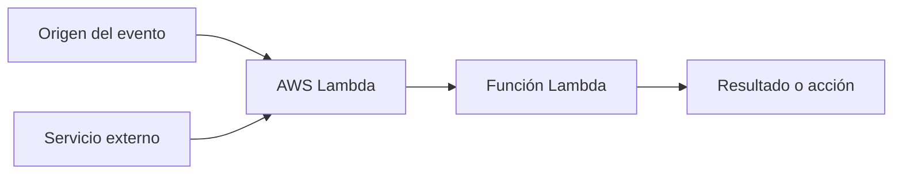

#### Conceptos fundamentales de Lambda

Antes de utilizar AWS Lambda, debes comprender estos conceptos:

- **Origen del evento:** determina qué inicia la invocación.
- **Elección del lenguaje:** lenguaje en el que se escribe la función.
- **Entorno de ejecución:** entorno donde se ejecuta el código.
- **Permisos:** autorizaciones necesarias para acceder a otros recursos.
- **Recursos:** memoria, tiempo de ejecución y otros recursos asignados.

El código que ejecutas en AWS Lambda se carga como una **función Lambda**.
Cada función tiene información de configuración asociada, como:

- Nombre.
- Descripción.
- Punto de entrada.
- Requisitos de recursos.

#### Código sin estado

El código de Lambda debe escribirse siguiendo un modelo **sin estado**.

Esto significa que la función debe asumir que no existe afinidad con la infraestructura de computación subyacente.
Por tanto:

- El acceso al sistema de archivos local puede no mantenerse entre invocaciones.
- Los procesos secundarios pueden no existir más allá de la duración de la solicitud.
- Otros elementos locales pueden desaparecer cuando finaliza la solicitud.
- El estado persistente debe almacenarse en un servicio externo.

Para guardar el estado persistente se pueden utilizar servicios como:

- Amazon S3.
- Amazon DynamoDB.
- Otros servicios de almacenamiento accesibles a través de Internet.

Las funciones Lambda también pueden incluir bibliotecas, incluidas bibliotecas nativas.

---

## Cuestionario de conocimiento

<!-- markdownlint-disable MD033 -->
<quiz>
**¿Cuál de las siguientes afirmaciones es verdadera sobre la computación sin servidor?**

- [ ] Los clientes deben aprovisionar y administrar servidores.
- [ ] Los clientes deben escalar manualmente los recursos sin servidor.
- [x] Las aplicaciones sin servidor tienen integraciones de servicios integradas.
- [ ] Los clientes deben administrar la disponibilidad y la tolerancia a errores.

*En la computación sin servidor, AWS gestiona los servidores, el escalado, la disponibilidad y la tolerancia a errores. Las aplicaciones pueden activarse e integrarse con otros servicios sin administrar esa infraestructura.*
</quiz>

<quiz>
**¿Cuál de las siguientes afirmaciones sobre contenedores y máquinas virtuales es correcta?**

- [ ] Las máquinas virtuales comparten un kernel del sistema operativo.
- [x] Los contenedores comparten un kernel del sistema operativo.
- [ ] Las máquinas virtuales deben utilizar el mismo sistema operativo que el hipervisor.
- [ ] Cada contenedor tiene su propio kernel.

*Los contenedores utilizan el kernel del sistema operativo anfitrión, por eso suelen iniciarse más rápido y consumir menos recursos que las máquinas virtuales. Una máquina virtual ejecuta su propio sistema operativo invitado.*
</quiz>

<quiz>
**¿Qué dos aspectos de una instancia de Amazon EC2 se identifican en el nombre de la instancia?**

- [x] La familia y el tamaño de la instancia.
- [ ] La ubicación de la instancia y el tamaño.
- [ ] La tenencia de la instancia y el modelo de facturación.
- [ ] La AMI y la velocidad de red.

*El nombre de una instancia EC2 identifica su familia —por ejemplo, propósito general o optimizada para memoria— y su tamaño, que determina los recursos disponibles, como vCPU, memoria y capacidad de red.*
</quiz>

---

!!! info "Acerca de este proyecto"
    - Esta documentación ha sido elaborada de forma independiente por **José Antonio Seguido Doblado** como material de estudio.
    - No constituye documentación oficial de Amazon Web Services (AWS).
