# Módulo 3: Redes en AWS

<!-- markdownlint-disable MD033 -->
<p align="center">
  
  
</p>
<!-- markdownlint-enable MD033 -->

## Objetivos

En este módulo explorarás:

- Amazon Virtual Private Cloud (Amazon VPC).
- Subredes.
- Tablas de rutas.
- Listas de control de acceso de red (network ACLs).
- Grupos de seguridad.
- Firewalls basados en host.
- Amazon VPC Flow Logs.

## Amazon Virtual Private Cloud (Amazon VPC)

**Amazon VPC** permite definir y aprovisionar una red virtual en AWS para tus recursos. Es equivalente, a nivel conceptual, a una red tradicional dentro de un centro de datos.

Al crear una VPC debes indicar indicar:

- La región.
- Un nombre para la VPC.
- Un rango de direcciones IP.

Una VPC abarca varias zonas de disponibilidad de la región seleccionada.

---

### Subredes

Una subred es una red más pequeña dentro de una VPC donde se ubican los recursos de AWS.
Las subredes pueden configurarse como:

- **Públicas:** orientadas a Internet.
- **Privadas:** sin acceso directo desde Internet.

La configuración de enrutamiento se aplica a nivel de subred y determina qué recursos pueden comunicarse con el exterior de la VPC.

Para alta disponibilidad, se recomienda crear subredes públicas y privadas en dos zonas de disponibilidad distintas.

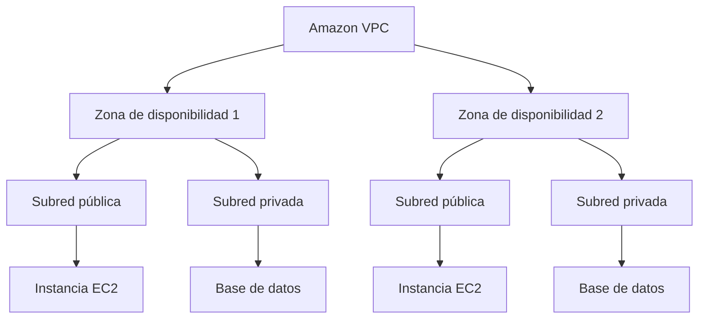

---

### Classless Inter-Domain Routing (CIDR)

CIDR es un método para especificar un rango de direcciones IP.

Al crear una VPC debes asignar un rango de direcciones IPv4 mediante un bloque CIDR. Este es el bloque CIDR principal de la VPC.

Por ejemplo:

`192.168.1.0/24`

En este caso:

- `192.168.1.0`.
- `/24` indica que los primeros 24 bits son fijos.
- Los últimos 8 bits son flexibles.
- La máscara de subred es `255.255.255.0`.

AWS reserva cinco direcciones IP en cada subred para:

- La dirección de red.
- El router.
- DNS.
- Uso futuro.
- Difusión.

Por tanto, un bloque `/24`, que contiene 256 direcciones, deja 251 direcciones disponibles para recursos.
Los rangos reservados para redes privadas son:

```text title="Rangos reservados redes privadas AWS"
10.x.x.x
172.16.x.x - 172.31.x.x
192.168.x.x
```

---

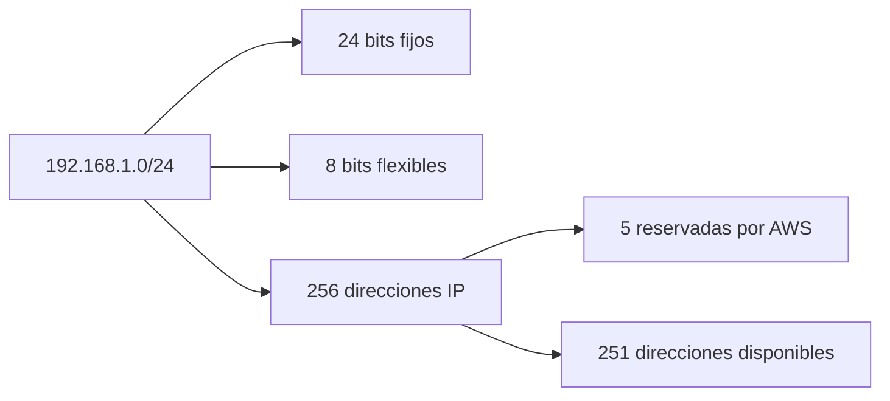

---

### Acceso a Internet o a una red remota

#### Internet Gateway

Una VPC se conecta a Internet mediante un **Internet Gateway**.

Este componente está diseñado para ser altamente disponible y escalar de forma transparente.

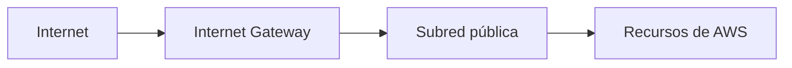

---

#### NAT Gateway

Los recursos ubicados en una subred privada pueden acceder a Internet mediante un **NAT Gateway**, sin permitir inicie conexiones hacia ellos.

Para alta disponibilidad, se debe crear un NAT Gateway en cada zona de disponibilidad. Así, si una zona deja de estar disponible, los recursos de las zonas restantes pueden seguir accediendo a Internet.

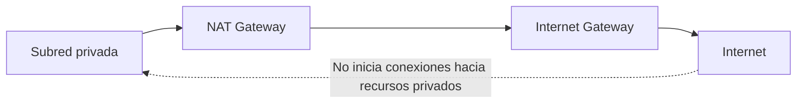

---

#### Virtual Private Network (VPN)

Para establecer una conexión virtual privada entre un centro de datos local y una VPC, se utiliza una VPN.

Para crear esta conexión debes:

1. Crear un virtual private gateway y asociarlo a la VPC.
2. Crear un customer gateway y conectarlo al centro de datos local.
3. Establecer la conexión VPN entre ambos gateways.

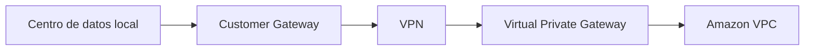

---

#### AWS Direct Connect

**AWS Direct Connect** permite establecer una conexión física y segura entre un centro de datos local y una VPC.

Con AWS Direct Connect puedes:

- Reducir costes de red.
- Aumentar el ancho de banda.
- Crear una interfaz virtual directamente hacia la VPC.

La red local se conecta a una ubicación de AWS Direct Connect mediante un cable de fibra óptica Ethernet estándar.
Esa ubicación proporciona acceso a AWS dentro de la región asociada.

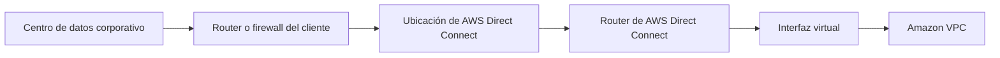

---

### Enrutamiento de Amazon VPC

#### Tablas de rutas

Las tablas de rutas controlan hacia dónde se dirige el tráfico de una red dentro de una VPC.
Cada subred de una VPC está a una tabla de rutas:

- Una tabla de rutas puede asociarse a varias subredes.
- Una subred solo puede asociarse a una tabla de rutas.

Cada ruta contiene:

- Un **destino**, que especifica el rango CIDR al que se dirige el tráfico.
- Un **objetivo**, que identifica el componente que debe utilizarse para alcanzar ese destino.

Por lo general, el origen del tráfico es una subred.

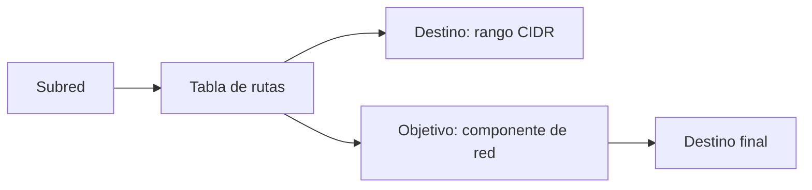

Por ejemplo, para permitir el acceso a Internet mediante un Internet Gateway con el identificador `ig-12345`:

```text title="Ejemplo de tabla de rutas"
Destino: 0.0.0.0/0
Objetivo: igw-12345
```

La ruta `0.0.0.0/0` se aplica a todo el tráfico que no coincida con una ruta más específica.
Todas las tablas de rutas incluyen una ruta local. Esta ruta no puede eliminarse.

#### Acceso desde una subred privada a Internet

Para conectar recursos de una subred privada a Internet mediante un NAT Gateway:

1. Crea un NAT Gateway con una Elastic IP en una subred pública.
2. Actualiza la tabla de rutas asociada a la subred privada.
3. Dirige el tráfico destinado a Internet hacia el NAT Gateway.

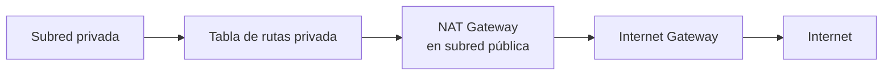

Cuando creas una VPC, AWS crea una tabla de rutas principal y la asocia a las subredes.
Por defecto, tanto las tablas de rutas principales como las personalizadas permiten el tráfico entre todas las subredes de la VPC.

Para personalizar el tráfico, debes:

- Crear una tabla de rutas personalizada.
- Añadir las rutas necesarias.
- Asociarla a las subredes correspondientes.

---

### Listas de control de acceso de red y grupos de seguridad

#### Listas de control de acceso de red

Una lista de control de acceso de red, o **network ACL**, es un firewall virtual que controla el tráfico entrante y saliente de una subred.
Las network ACL tienen reglas independientes para:

- Tráfico entrante.
- Tráfico saliente.

Cada regla puede permitir o denegar tráfico.
Las network ACL son **sin estado**. Esto significa que, aunque una regla permita que el tráfico entre en la subred, debe existir otra regla para permitir el tráfico de respuesta en dirección de salida.

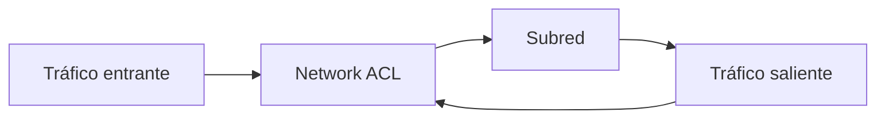

Cada VPC incluye una network ACL predeterminada que permite todo el tráfico IPv4 entrante y saliente, cuando corresponda.
Si una subred no tiene asociada no tiene asociada una network ACL personalizada, utilizará la predeterminada.
Una network ACL personalizada:

- Deniega todo el tráfico entrante de forma predeterminada.
- Deniega todo el tráfico saliente de forma predeterminada.
- Requiere reglas explícitas para permitir tráfico.

Una network ACL puede asociarse a varias subredes, pero una subred solo puede asociarse a una network ACL.
Si asocias una network ACL personalizada a una subred que ya tiene otra asociada, la asociación anterior se reemplaza.

#### Grupos de seguridad

Un grupo de seguridad es un firewall virtual que controla el tráfico entrante y saliente de las instancias de Amazon EC2

Los grupos de seguridad son **con estado**. Una vez permitido el tráfico hacia una instancia, el grupo recuerda la sesión y permite automáticamente el tráfico de respuesta, sin comprobar reglas adicionales de salida.

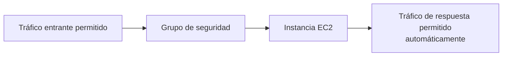

De forma predeterminada, un grupo de seguridad  permite solo el tráfico saliente.
Para permitir tráfico entrante, debes crear reglas de entrada.
El origen de una regla de entrada puede ser:

- El ID de otro grupo de seguridad.
- Un bloque CIDR.
- Una dirección IP.

---

### Seguridad en todas las capas

Como medida de seguridad adicional, puedes habilitar firewalls basados en host dentro de las instancias EC2
Los firewalls basados en host son firewalls del sistema operativo. Entre ellos se incluyen:

- `iptables`.
- Windows Firewall.
- Software de seguridad de terceros, por ejemplo para inspección profunda de paquetes o protección frente a amenazas de red.

Este tipo de software funciona bien en arquitecturas distribuidas y escalables porque la inspección de paquetes se distribuye entre todos los componentes de la aplicación.

#### Amazon VPC Flow Logs

Para supervisar el tráfico que entra y sale de una interfaz de red de una VPC, puedes habilitar VPC Flow Logs.
Los Flow Logs capturan información del tráfico de red para:

- Una VPC.
- Una subred.
- Una interfaz de red.

Por ejemplo, si determinado tráfico no llega a una instancia, puedes consultar los registros para investigar la causa.

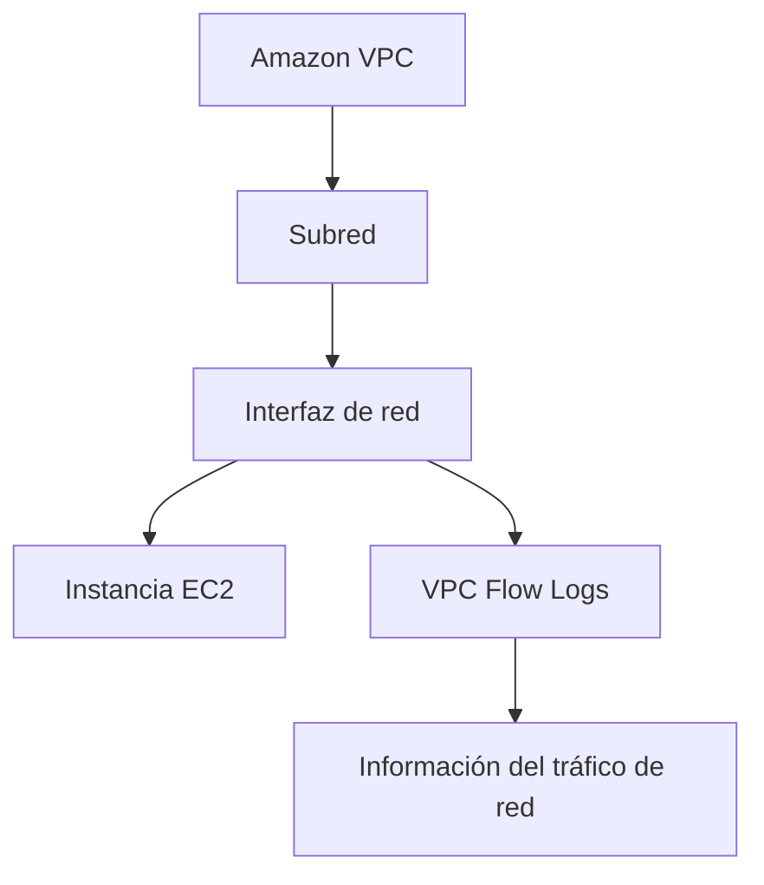

### Buenas prácticas de seguridad

Para proteger una VPC, el material recomienda:

- Utilizar varias zonas de disponibilidad para alta disponibilidad.
- Utilizar network ACLs y grupos de seguridad.
- Usar políticas de IAM para controlar el acceso.
- Utilizar Flow Logs para capturar información del tráfico hacia y desde las interfaces de red de la VPC.

---

## Cuestionario de conocimiento

<!-- markdownlint-disable MD033 -->
<quiz>
**¿A cuál de los siguientes elementos se puede asociar una tabla de rutas?**

- [ ] Cuentas de AWS.
- [ ] Zonas de disponibilidad.
- [x] Subredes.
- [ ] Regiones.

*Cada subred de una VPC se asocia a una única tabla de rutas, que determina cómo se dirige su tráfico. Una tabla de rutas, en cambio, puede utilizarse para varias subredes.*
</quiz>

<quiz>
**Dadas las reglas de un grupo de seguridad, si una instancia EC2 envía una solicitud a un cliente, ¿qué cambio es necesario para que la instancia reciba la respuesta?**

- [ ] Definir reglas de entrada HTTP/HTTPS en el grupo de seguridad.
- [x] No realizar ningún cambio en las tablas.
- [ ] Usar una network ACL en lugar de un grupo de seguridad.
- [ ] Eliminar todas las reglas de la tabla de salida.

*Los grupos de seguridad son con estado. Si la instancia EC2 inicia una conexión permitida, el grupo de seguridad recuerda la sesión y permite automáticamente el tráfico de respuesta, sin necesitar una regla de entrada adicional.*
</quiz>
<!-- markdownlint-enable MD033 -->

---

!!! info "Acerca de este proyecto"
    - Esta documentación ha sido elaborada de forma independiente por **José Antonio Seguido Doblado** como material de estudio.
    - No constituye documentación oficial de Amazon Web Services (AWS).
