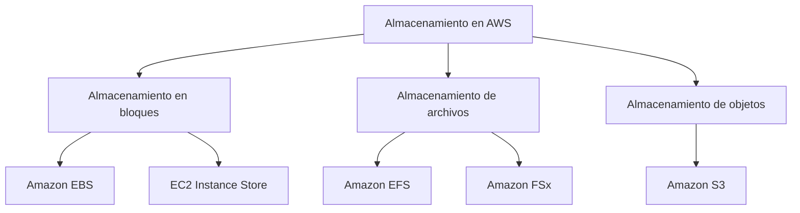
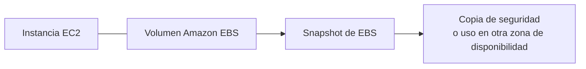
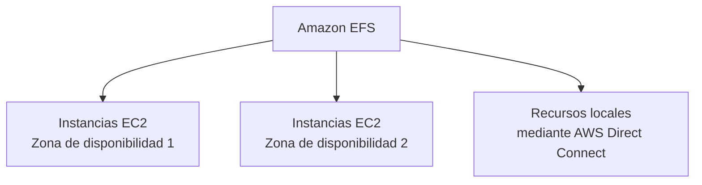
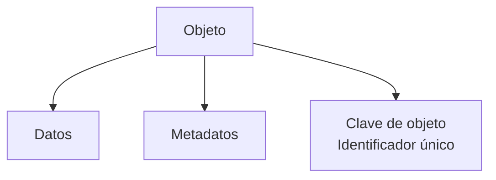
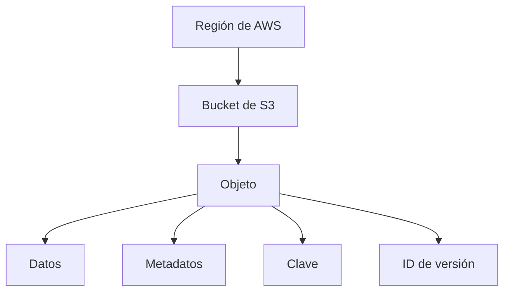
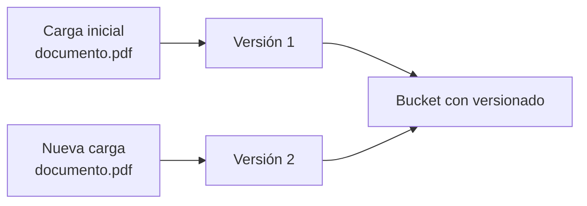

# Módulo 4: Almacenamiento en AWS

<!-- markdownlint-disable MD033 -->

  
  

<!-- markdownlint-enable MD033 -->

## Objetivos

En este módulo se exploran los siguientes tipos de almacenamiento:

- Almacenamiento en bloques.
  - Amazon Elastic Block Store (Amazon EBS).
  - Almacenamiento de instancias de Amazon EC2.
- Almacenamiento de archivos.
  - Amazon Elastic File System (Amazon EFS).
  - Amazon FSx.
- Almacenamiento de objetos.
  - Amazon Simple Storage Service (Amazon S3).

## Tipos de almacenamiento

AWS presenta tres categorías principales:

- Almacenamiento en bloques.
- Almacenamiento de archivos.
- Almacenamiento de objetos.

### Almacenamiento en bloques

En el almacenamiento en bloques, los datos se guardan en un dispositivo dividido en bloques de tamaño fijo, por ejemplo, de 512 bytes.
Las aplicaciones y los sistemas de archivos regulan cómo se accede a estos bloques, cómo se combinan y cómo se modifican.

#### Tipos de almacenamiento en bloques

AWS ofrece dos tipos:

- Almacenamiento de instancias EC2.
- Amazon Elastic Block Store (Amazon EBS).

##### EC2 Instance Store

El almacenamiento de instancia es el almacenamiento temporal a nivel de bloque para una instancia de EC2
Sus características son:

- Esta preconfigurado y asociado a la instancia.
- Se encuentra en el mismo servidor físico que aloja la instancia EC2.
- Los datos se pierden si la instancia se detiene o termina.

##### Amazon Elastic Block Store

Amazon EBS proporciona almacenamiento desacoplable asociado a una zona de disponibilidad, de forma similar a un disco duro externo conectado a un ordenador portátil.
Si una instancia EC2 se detiene o termina, los datos del volumen EBS continúan disponibles.

Un volumen EBS puede:

- Desasociarse de una instancia.
- Asociarse a otra instancia.
- Respaldarse mediante snapshots.

Un snapshot representa una copia de seguridad completa. Sin embargo, el almacenamiento consumido por cada snapshot es incremental respecto de los snapshots anteriores, mediante el mapeo de bloques correspondientes.

##### Amazon EBS Multi-Attach

Amazon EBS Multi-Attach permite asociar un único volumen SSD de IOPS aprovisionadas —`io1` o `io2`— a varias instancias de la misma zona de disponibilidad.

Esta capacidad ayuda a mejorar la disponibilidad de aplicaciones Linux en clúster que gestionan operaciones de escritura simultáneas.

##### Tipos de volumen de Amazon EBS

Los volúmenes EBS se agrupan en:

- **Unidades de estado sólido (SSD):**
  - Cargas de trabajo aleatorias moderadas o de gama media.
  - Sustitución de redes de área de almacenamiento de alto rendimiento.
- **Unidades de disco duro (HDD):**
  - Cargas de trabajo moderadas.
  - Cargas de streaming de alto rendimiento.
  - No pueden utilizarse como discos de arranque.

---

### Almacenamiento de archivos

El almacenamiento de archivos permite que usuarios, aplicaciones y servicios accedan a los datos mediante un sistema de archivos compartido.
Es similar a una unidad de red centralizada de una empresa, donde los empleados almacenan y consultan archivos.

#### Amazon Elastic File System

**Amazon EFS** es un sistema de archivos escalable que puede utilizarse con servicios de AWS y recursos locales.

Amazon EFS:

- Admite miles de conexiones desde instancias EC2 ubicadas en varias zonas de disponibilidad.
- Puede montarse en una VPC mediante los protocolos NFS versión 4.0 y 4.1.
- Permite el acceso desde servidores locales mediante AWS Direct Connect.

#### Amazon FSx for Windows File Server

**Amazon FSx for Windows File Server** proporciona almacenamiento de archivos administrado, fiable y escalable, accesible mediante el protocolo Server Message Block (SMB).
Incluye:

- Implementaciones Single A-Z y Multi-AZ.
- Integración con Microsoft Active Directory.
- Copias de seguridad administradas.
- Almacenamiento HDD y SSD.

#### Amazon FSx

**Amazon FSx** ofrece almacenamiento conectado a red en la nube.
El nombre representa _File System X_, donde `X` es el tipo de carga de trabajo elegido.
Ofrece sistemas de archivos para:

<!-- cSpell:disable-next-line -->
- NetApp ONTAP.
- OpenZFS.
- Windows File Server.
- Lustre.

Sus características incluyen:

- Funcionalidades completas.
- Alta disponibilidad.
- Optimización de costes.
- Integración con entornos híbridos.

---

### Almacenamiento de objetos

En el almacenamiento de objetos, los archivos se almacenan como objetos.
Cada objeto está formado por:

- Datos
- Metadatos.
- Una clave de objeto.

Los metadatos contienen información sobre los datos, como el tamaño o el propósito del objeto.
La clave del objeto es su identificador único.
A diferencia del almacenamiento en bloques, al actualizar un archivo en almacenamiento de objetos se actualiza el objeto completo, no solo una parte del archivo.

#### Amazon Simple Storage Service

Amazon Simple Storage Service, o **Amazon S3**, es un servicio de almacenamiento de objetos.
En lugar de asociar el almacenamiento a una instancia, los datos se recuperan mediante la web.

Amazon S3 es altamente escalable y permite almacenar una cantidad ilimitada de datos.

##### Objetos, claves y buckets

Los archivos cargados en Amazon S3 son objetos.
Un objeto contiene:

- Datos.
- Metadatos, como el tipo de contenido o la fecha de la última modificación.
- Una clave que lo identifica de forma única.

El tamaño máximo de un objeto en Amazon S3 es de 5 TB.
Los objetos se almacenan en un bucket, de forma similar a una carpeta o un directorio.

Los buckets:

- Se crean dentro de una región.
- Deben tener un nombre único globalmente.
- Son privados de forma predeterminada.

Un objeto queda identificado de forma única por la combinación de:

- Nombre del bucket.
- Clave del objeto.
- ID de versión.

Los permisos de acceso pueden aplicarse:

- A nivel de bucket.
- A nivel del objeto.
- En ambos niveles.

##### Seguridad de Amazon S3

Para conceder acceso a Amazon S3 a usuarios, grupos y roles se utilizan políticas de IAM.

Por ejemplo, se puede asociar un rol de IAM a una instancia de EC2 si una aplicación que se ejecuta en ella necesita recuperar un archivo de un bucket S3.
También se puede pueden utilizar políticas de bucket, escritas con el lenguaje de políticas de IAM basado en JSON.

Una política de bucket tiene un límite de 20 KB.
Para configurar permisos muy específicos sobre muchos objetos, se puede utilizar una lista de control de acceso S3, o ACL.

Los ACL definen:

- Qué cuentas o grupos reciben acceso al bucket u objeto.
- Qué tipo de acceso se concede.

Al crear un bucket u objeto, S3 Block Public Access está habilitado de forma predeterminada y las ACL están deshabilitadas.
S3 Block Public Access proporciona configuraciones para puntos de acceso, buckets y cuentas, con el fin de gestionar el acceso público a los recursos de S3.

###### Cifrado

Los datos pueden protegerse al cargarlos o descargarlos mediante:

- Secure Sockets Layer/Transport Layer Security (SSL/TSL).
- Cifrado del lado del cliente.

Los datos en reposo se pueden proteger mediante:

- Cifrado del lado del servidor.
- Cifrado del lado del cliente.

Con cifrado del lado del servidor, Amazon S3 cifra los datos a nivel de objeto y los descifra al descargarlos.
Con cifrado del lado del cliente, los datos se cifran antes de cargarse al bucket.

##### Clases de almacenamiento de Amazon S3

Las clases presentadas en la guía son:

| Clase                         | Uso principal                                                               |
| ----------------------------- | --------------------------------------------------------------------------- |
| Amazon S3 Standard            | Datos de acceso frecuente, como sitios web y distribución de contenido.     |
| S3 Standard-Infrequent Access | Datos de acceso menos frecuente que deben estar disponibles al solicitarse. |
| S3 One Zone-Infrequent Access | Datos poco accedidos que pueden recrearse si se pierden.                    |
| S3 Intelligent-Tiering        | Datos con patrones de acceso cambiantes o desconocidos.                     |
| S3 Glacier Instant Retrieval  | Datos de larga duración, poco accedidos y recuperables en milisegundos.     |
| S3 Glacier Flexible Retrieval | Datos archivados con opciones de recuperación desde minutos hasta horas.    |
| S3 Glacier Deep Archive       | Datos archivados que se consultan muy rara vez.                             |

###### S3 Standard

Es la clase de almacenamiento predeterminada.
Se utiliza para datos de acceso frecuente, por ejemplo:

- Sitios web.
- Distribución de contenido.

Los datos se almacenan en un mínimo de tres zonas de disponibilidad.

###### S3 Standard-Infrequent Access

Se utiliza para datos a los que se accede con menor frecuencia, pero que deben tener alta disponibilidad cuando se soliciten.
Los datos se almacenan en un mínimo de tres de zonas de disponibilidad.
Tiene un precio de almacenamiento por GB reducido y un cargo de recuperación de datos.

###### S3 One Zone-Infrequent Access

Se utiliza para datos poco consultados que pueden recrearse fácilmente si se pierden.
Los datos se almacenan en una única zona de disponibilidad.

###### S3 Intelligent-Tiering

Se utiliza para datos con patrones de acceso variables o desconocidos.
Optimiza los costes al mover automáticamente los datos a la capa de acceso más rentable según los patrones de acceso.

###### S3 Glacier Instant Retrieval

Es una clase de archivo para datos de larga duración y poco acceso que requieren recuperación en milisegundos.

###### S3 Glacier Flexible Retrieval

Ofrece opciones de recuperación que equilibran el coste y tiempo de acceso, desde minutos hasta horas, e incluye recuperaciones masivas sin coste.

###### S3 Glacier Deep Archive

Está destinada a archivar datos a los que se accede muy raramente.

##### Versionado de Amazon S3

El versionado permite conservar varias versiones de un objeto en el mismo bucket.
Al actualizar un objeto con el mismo nombre sin versionado, el objeto nuevo reemplaza al anterior.
Con el versionado habilitado:

- Cada carga genera una nueva versión del objeto.
- Cada objeto obtiene un ID de versión.
- Se protege frente a eliminaciones accidentales.
- Al eliminar un objeto se crea un marcador de eliminación, que puede retirarse posteriormente.

El versionado se habilita a nivel de bucket y está deshabilitado de forma predeterminada.
Un bucket puede encontrarse en uno de estos estados:

- **Sin versionado:** estado predeterminado; los objetos no reciben versiones.
- **Versionado habilitado:** todos los objetos se versionan.
- **Versionado suspendido:** los nuevos objetos reciben un ID de versión nulo; las versiones anteriores se conservan.

---

## Cuestionario de conocimiento

<!-- markdownlint-disable MD033 -->
<quiz>
**¿Cuál de los siguientes en un caso de uso habitual de Amazon S3?**

- [x] Almacenamiento de objetos para alojar contenido multimedia.
- [ ] Almacenamiento de objetos para una unidad de arranque.
- [ ] Almacenamiento en bloques para una instancia de EC2.
- [ ] Almacenamiento de archivos para varias instancias EC2.

_Amazon S3 es un servicio de almacenamiento de objetos, adecuado para guardar y distribuir archivos multimedia. Las unidades de arranque y el almacenamiento en bloques se asocian en EBS; el almacenamiento compartido entre instancias se asocia a servicios de archivos como EFS._
</quiz>

<quiz>
**¿Qué servicio se recomienda para proporcionar una capa de almacenamiento a una base de datos relacional con muchas transacciones en una instancia EC2?**

- [ ] Amazon S3.
- [ ] Amazon EFS.
- [x] Amazon EBS.
- [ ] Amazon S3 Glacier.

_EBS proporciona almacenamiento en bloques desacoplable para instancias EC2. Es adecuado cuando una carga de trabajo, como una base de datos relacional, necesita almacenamiento persistente conectado a una instancia._
</quiz>

<quiz>
Una persona debe conservar durante siete años información de pacientes a la que se accede raramente. ¿Qué clase de almacenamiento de S3 se debe utilizar?

- [ ] Amazon S3 Standard.
- [x] Amazon S3 Glacier Deep Archive.
- [ ] S3 Standard-Infrequent Access.
- [ ] S3 Intelligent-Tiering.

_Glacier Deep Archive está pensando para datos archivados que se consultan con muy poca frecuencia y se conservan durante periodos prolongados._
</quiz>
<!-- markdownlint-enable MD033 -->

---

!!! info "Acerca de este proyecto"
    - Esta documentación ha sido elaborada de forma independiente por **José Antonio Seguido Doblado** como material de estudio.
    - No constituye documentación oficial de Amazon Web Services (AWS).
