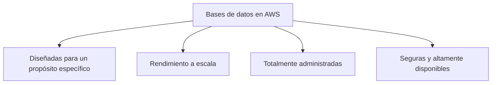
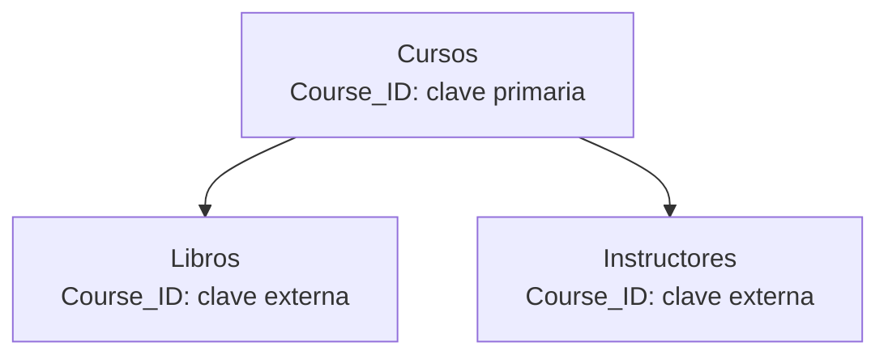
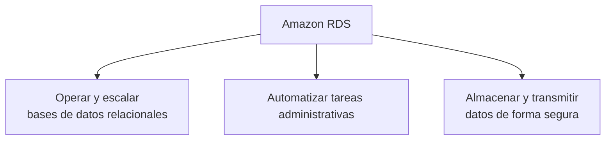
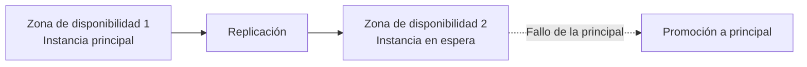
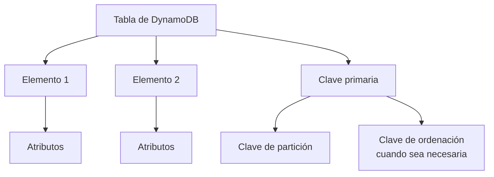

# Módulo 5: Bases de datos

<!-- markdownlint-disable MD033 -->

  
  

<!-- markdownlint-enable MD033 -->

## Objetivos

En este módulo explorarás:

- Las ventajas de las bases de datos en AWS.
- Los tipos de bases de datos.
- Amazon Relational Database Service (Amazon RDS).
- Amazon DynamoDB.

## Ventajas de las bases de datos en AWS

Las bases de datos en AWS ofrecen estas ventajas:

- **Diseñadas para un propósito específico:** AWS ofrece más de 15 motores de bases de datos para distintos modelos, entre ellos relacional, clave-valor y documentos.
- **Rendimiento a escala:** AWS ofrece bases de datos relacionales y no relacionales pensadas para cargas de trabajo de alto rendimiento y baja latencia.
- **Totalmente administradas:** AWS gestiona tareas como el aprovisionamiento de servidores, la aplicación de parches, la configuración y las copias de seguridad.
- **Seguras y altamente disponibles:** las bases de datos de AWS ofrecen alta disponibilidad, fiabilidad, seguridad, compatibilidad multi-región y cifrado de extremo a extremo.

## Tipos de bases de datos

AWS admite ocho tipos principales de bases de datos:

| Tipo              | Uso habitual                                                                             |
| ----------------- | ---------------------------------------------------------------------------------------- |
| Relacional        | Aplicaciones tradicionales, ERP, CRM y comercio electrónico.                             |
| Clave-valor       | Aplicaciones web de gran tráfico, comercio electrónico y videojuegos.                    |
| En memoria        | Caché, gestión de sesiones, clasificaciones de videojuegos y aplicaciones geoespaciales. |
| Documental        | Gestión de contenido, catálogos y perfiles de usuario.                                   |
| Columna ancha     | Mantenimiento de equipos, gestión de flotas y optimización de rutas.                     |
| Grafo             | Detección de fraude, redes sociales y motores de recomendación.                          |
| Series temporales | IoT, DevOps y telemetría industrial.                                                     |
| Libro mayor       | Sistemas de registro, cadena de suministro, registros y transacciones bancarias.         |

En este curso se desarrollan las bases de datos relacionales y las de clave-valor.

## Servicios de bases de datos de AWS

| Tipo              | Servicios de AWS                                                                 |
| ----------------- | -------------------------------------------------------------------------------- |
| Relacional        | Amazon Aurora, Amazon RDS y Amazon Redshift                                      |
| Clave-valor       | Amazon DynamoDB                                                                  |
| En memoria        | Amazon ElastiCache for Memcached, Amazon ElastiCache for Redis y Amazon MemoryDB |
| Documental        | Amazon DocumentDB                                                                |
| Columna ancha     | Amazon Keyspaces                                                                 |
| Grafo             | Amazon Neptune                                                                   |
| Series temporales | Amazon Timestream                                                                |
| Libro mayor       | Amazon Quantum Ledger Database (Amazon QLDB)                                     |

---

## Bases de datos relacionales

Una base de datos relacional es una colección de registros organizada en tablas compuestas por filas y columnas.

- Cada fila representa un registro.
- Cada columna contiene un atributo de los datos.
- Una **clave primaria** identifica de forma única cada registro.
- Una **clave externa** referencia una clave primaria de otra tabla.

Por ejemplo, en un sistema de cursos podrían existir estas tablas:

- Cursos.
- Libros.
- Instructores.

Las tres se relacionan mediante el valor `Course_ID`.

### Ventajas de las bases de datos relacionales

Entre sus ventajas se encuentran:

- Consultas SQL complejas.
- Menor redundancia de datos.
- Familiaridad para muchos profesionales técnicos.
- Cumplimiento del principio ACID.

#### SQL

El lenguaje utilizado para consultar datos en una base relacional se denomina **Structured Query Language (SQL)**.
SQL permite combinar varias tablas en una consulta mediante uniones.

#### Reducción de redundancia

Las bases de datos relacionales almacenan un dato una sola vez y lo referencian desde otras tablas cuando es necesario.
Por ejemplo, si varias personas viven en la misma dirección, la dirección puede guardarse una única vez en una tabla `Address` y referenciarse desde los registros de cada persona.

### Principio ACID

Las bases de datos relacionales se caracterizan por cumplir el principio:

- **Atomicidad.**
- **Consistencia.**
- **Aislamiento.**
- **Durabilidad.**

### Bases de datos locales frente a instancias EC2

En una base de datos alojada en una instancia local, el cliente es responsable de administrar todos los componentes, incluidos:

- Optimización de aplicaciones.
- Escalado.
- Alta disponibilidad.
- Copias de seguridad.
- Parches e instalación del software de base de datos.
- Parches e instalación del sistema operativo.
- Mantenimiento del servidor.
- Montaje e instalación del hardware.
- Alimentación eléctrica, climatización y red de la sala de servidores.

Cuando una base de datos se implementa en una instancia de Amazon EC2, la responsabilidad se comparte:

| Cliente                                             | AWS                                                             |
| --------------------------------------------------- | --------------------------------------------------------------- |
| Optimización de aplicaciones                        | Instalación del sistema operativo                               |
| Escalado                                            | Mantenimiento del servidor                                      |
| Alta disponibilidad                                 | Montaje e instalación del hardware                              |
| Copias de seguridad                                 | Alimentación eléctrica, climatización y red del centro de datos |
| Parches e instalación del software de base de datos |                                                                 |
| Parches del sistema operativo                       |                                                                 |

---

## Bases de datos administradas en AWS

En una base de datos alojada en un servicio administrado de AWS, el cliente se responsabiliza de la optimización de la aplicación.
AWS se encarga del resto, incluido:

- Escalado.
- Alta disponibilidad.
- Copias de seguridad.
- Parches del software de base de datos.
- Parches e instalación del sistema operativo.
- Mantenimiento de servidores.
- Montaje e instalación del hardware.
- Alimentación eléctrica, climatización y red del centro de datos.

### Amazon Relational Database Service

Amazon RDS es un servicio web administrado para crear y gestionar base de datos relacionales escalables y seguras en AWS.
El cliente no es responsable:

- Aprovisionar hardware.
- Configurar la base de datos.
- Aplicar parches al software.
- Crear copias de seguridad.

AWS administra esas tareas operativas.

#### Instancias de base de datos

Una instancia de base de datos, o **DB Instance**, es un componente fundamental de Amazon RDS.
Es un entorno de base de datos aislado que se ejecuta en la nube.
Una instancia puede alojar varias bases de datos y se puede administrar mediante:

- AWS CLI.
- Operaciones de la API de Amazon RDS.
- AWS Management Console.
- Aplicaciones cliente SQL estándar.

Amazon RDS no permite acceso directo al host.
Cada instancia admite un motor de base de datos, como Oracle, Microsoft SQL Server o PostgreSQL. Sus características y configuraciones dependen del motor elegido.

#### Clases de instancia

Las instancias RDS se ejecutan sobre instancias EC2 administradas por AWS.
La clase seleccionada determina la capacidad de computación y memoria de la instancia RDS.
Amazon RDS admite tres tipos de clase:

| Tipo                    | Uso                                                                      |
| ----------------------- | ------------------------------------------------------------------------ |
| Estándar                | Instancias de propósito general.                                         |
| Optimizada para memoria | Aplicaciones que requieren mucha memoria.                                |
| Rendimiento ampliable   | Rendimiento base con capacidad de aumentar hasta el uso completo de CPU. |

#### Almacenamiento de la instancia

Para los motores MySQL, MariaDB, PostgreSQL, Oracle y Microsoft SQL Server, las instancias RDS utilizan volúmenes de Amazon EBS para almacenar la base de datos y los registros.

Amazon RDS distribuye automáticamente los datos entre varios volúmenes EBS según el almacenamiento solicitado, con el objetivo de mejorar el rendimiento.
Los tipos de almacenamiento:

- **SSD de propósito general:** opción rentable para una amplia variedad de cargas de trabajo.
- **IOPS aprovisionadas:** para cargas de trabajo intensivas en E/S que necesitan baja latencia y alto rendimiento.
- **Magnético:** se mantiene por compatibilidad con versiones anteriores; no se recomienda para nuevas necesidades de almacenamiento.

#### Seguridad de RDS

Al crear una instancia RDS, se recomienda ubicarla en una subred privada de una VPC.
Así, las aplicaciones realizan sus consultas dentro del límite aislado de la VPC, evitando exponer la instancia directamente a Internet desde una subred pública.
Buenas prácticas indicadas:

- Crear un usuario de IAM individual para cada persona que gestione recursos RDS.
- No utilizar la cuenta raíz de AWS para administrar RDS.
- Conceder el conjunto mínimo de permisos necesario.
- Habilitar el cifrado de RDS para proteger instancias y snapshots en reposo.
- Rotar las credenciales de IAM periódicamente.
- Crear las instancias RDS dentro de subredes privadas.

#### Copias de seguridad

RDS permite utilizar copias automáticas y snapshots de base de datos.

**Copias de seguridad automáticas:**

- Se habilitan de forma predeterminada al crear una base de datos RDS.
- Respaldan la base de datos completa y los registros de transacciones mediante un snapshot del volumen de almacenamiento.
- Permiten configurar un periodo de retención de hasta 35 días.
- Permiten restaurar la instancia a un momento específico dentro de ese periodo.
- La restauración crea una nueva instancia de base de datos.

**Snapshots de base de datos:**

- Son copias manuales.
- Sirven para conservar copias automatizadas durante más de 35 días.
- Se almacenan en Amazon S3.
- Permanecen disponibles hasta que se eliminan.

#### Redundancia con Multi-AZ

Al habilitar Amazon RDS Multi-AZ, RDS crea una copia secundaria de la base de datos en otra zona de disponibilidad.
La copia secundaria funciona como instancia en espera.
Si la base de datos principal deja de responder:

1. RDS convierte la instancia en espera en la nueva principal.
2. Crea una nueva instancia en espera o convierte la principal anterior en espera.
3. Mantiene activa la configuración Multi-AZ.

### Amazon DynamoDB

Amazon DynamoDB es un servicio de base de datos NoSQL de clave-valor totalmente administrado.
Ofrece:

- Rendimiento rápido y predecible.
- Escalabilidad transparente.
- Cifrado en reposo.
- Alta disponibilidad y durabilidad integradas.

DynamoDB es sin servidor, por lo que no es necesario aprovisionar, aplicar parches, instalar ni operar servidores o aplicaciones de bases de datos.
DynamoDB distribuye automáticamente los datos y el tráfico de las tablas entre los servidores necesarios para cubrir los requisitos de rendimiento y almacenamiento.

Los datos se almacenan en unidades SSD y se replican automáticamente entre varias zonas de disponibilidad de una región.
Las tablas globales permiten mantener tablas de DynamoDB sincronizadas entre regiones de AWS.

#### Componentes principales de DynamoDB

DynamoDB utiliza tres componentes principales:

| Componente        | Descripción                                                          |
| ----------------- | -------------------------------------------------------------------- |
| Tabla             | Colección de datos.                                                  |
| Elemento (_item_) | Grupo de atributos identificable de forma única dentro de una tabla. |
| Atributo          | Elemento fundamental de datos que no necesita descomponerse más.     |

Cada tabla puede contener un número ilimitado de elementos.
Debes definir una clave primaria para cada tabla. Esta determina cómo se distribuyen los elementos entre particiones, que son recursos subyacentes de AWS utilizados para mejorar el rendimiento.

- Si la clave de partición es única, puede utilizarse como clave primaria.
- Si no es única, se debe añadir una clave de ordenación.
- La clave de partición y la clave de ordenación forman una clave primaria compuesta.

---

## Cuestionario de conocimiento

<!-- markdownlint-disable MD033 -->
<quiz>
**Un arquitecto de soluciones de AWS necesita una base de datos para un conjunto de datos con variaciones: no todos los datos comparten los mismos atributos. ¿Qué base de datos debe elegir?**

- [ ] Amazon RDS.
- [ ] Amazon Neptune.
- [x] Amazon DynamoDB.
- [ ] Amazon QLDB.

_DynamoDB es una base de datos NoSQL de clave-valor. Sus elementos pueden contener conjuntos de atributos diferentes, por lo que se adapta a datos cuya estructura no es uniforme._
</quiz>

<quiz>
Al utilizar Amazon RDS, ¿qué tarea de base de datos es responsabilidad del cliente?

- [x] Optimizar la base de datos.
- [ ] Aprovisionar y gestionar la infraestructura subyacente.
- [ ] Instalar el sistema de gestión de base de datos relacionales en la instancia.
- [ ] Instalar parches del sistema operativo de la instancia.

_RDS es un servicio administrado: AWS gestiona la infraestructura, el software, los parches y las copias de seguridad. El cliente sigue siendo responsable de optimizar su aplicación y su base de datos._
</quiz>
<!-- markdownlint-enable MD033 -->

---

!!! info "Acerca de este proyecto"
    - Esta documentación ha sido elaborada de forma independiente por **José Antonio Seguido Doblado** como material de estudio.
    - No constituye documentación oficial de Amazon Web Services (AWS).
