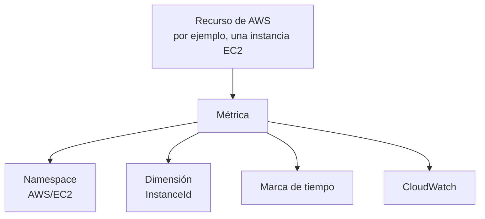
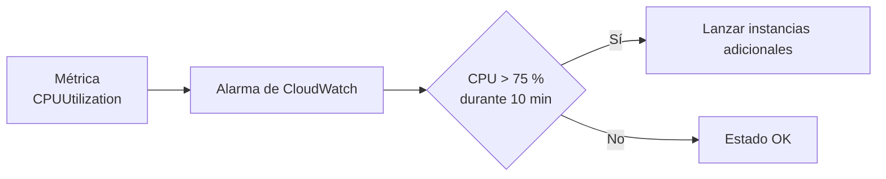
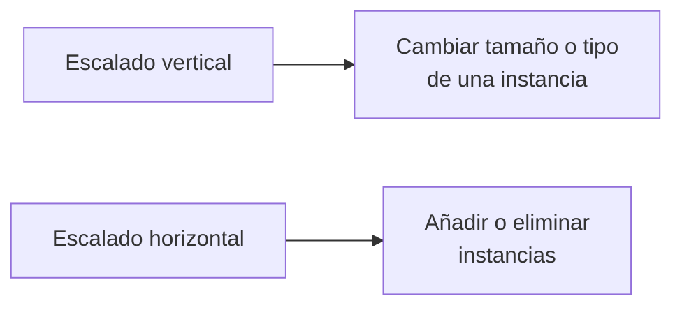
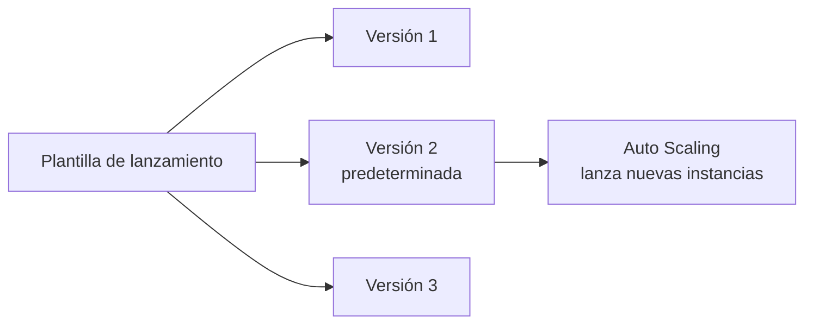
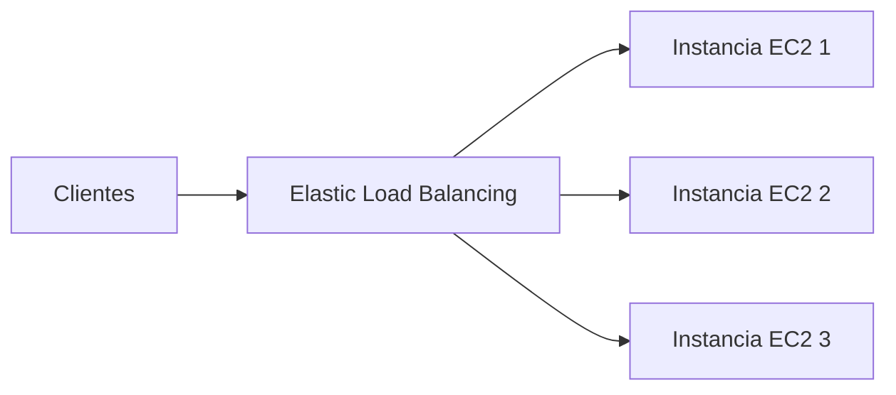

# Módulo 6: Monitorización, balanceo de carga y escalado

<!-- markdownlint-disable MD033 -->

  
  

<!-- markdownlint-enable MD033 -->

## Objetivos

En este módulo explorarás:

- Capacidades de monitorización de Amazon CloudWatch.
- Amazon EC2 Auto Scaling.
- Elastic Load Balancing.

## Monitorización

La monitorización permite:

- Responder de manera proactiva a problemas operativos.
- Mejorar el rendimiento y la fiabilidad.
- Reconocer amenazas y eventos.

## Amazon CloudWatch

Amazon CloudWatch permite supervisar recursos e infraestructuras de AWS y locales desde una única ubicación, prácticamente en tiempo real.
También proporciona acceso centralizado a las métricas.

### Métricas de CloudWatch

Las métricas son datos sobre el rendimiento de los sistemas.
Por defecto, CloudWatch incluye métricas para muchos servicios, entre ellos:

- Amazon EC2.
- Amazon EBS.
- Amazon RDS.

También puedes habilitar métricas adicionales y publicar métricas personalizadas para controlar, por ejemplo, el tráfico de un sitio web o el comportamiento de una aplicación.
Cada métrica:

- Tiene una marca de tiempo.
- Se organiza en un _namespace_.
- Puede incluir una dimensión.

Los _namespaces_ aíslas las métricas. AWS suele utilizar el formato `AWS/Servicio`; por ejemplo, las métricas de EC2 usan el namespace `AWS/EC2`.
Una dimensión es un par clave-valor que se adjunta a una métrica para filtrar resultados. Por ejemplo, se puede especificar el ID de una instancia para consultar las estadísticas de una instancia EC2 concreta.
Las métricas personalizadas de alta resolución pueden publicarse con gran detalle temporal. CloudWatch las agrega con una granularidad mínima de un segundo.

### Paneles de CloudWatch

Los paneles de CloudWatch son páginas personalizadas para visualizar una o varias métricas mediante widgets, como:

- Gráficos.
- Diagramas.
- Texto.
- Números.
- Tablas.

Se pueden crear distintos paneles, cada uno centrado en una vista diferente del entorno.
También pueden reunir datos de regiones distintas para ofrecer una vista global de la arquitectura.

### Alarmas de CloudWatch

Las alarmas permiten automatizar acciones basadas en cambios sostenidos del estado de las métricas.
Al crear una alarma debes elegir:

- La métrica.
- El umbral.
- El periodo de tiempo.

Los estados de una alarma son:

| Estado              | Significado                                                      |
| ------------------- | ---------------------------------------------------------------- |
| `OK`                | La métrica o expresión está dentro del umbral definido.          |
| `ALARM`             | La métrica o expresión está fuera del umbral definido.           |
| `INSUFFICIENT_DATA` | No hay suficientes datos para determinar el estado de la alarma. |

Una alarma puede activar acciones cuando cambia de estado, como:

- Una acción sobre EC2.
- Una acción de Auto Scaling.
- El envío de una notificación.

---

## Escalado

### Escalado vertical

El escalado vertical consiste en aumentar o reducir la capacidad de un servidor, por ejemplo:

- Memoria.
- Espacio de disco.
- Tipo o tamaño de instancia EC2.

Para escalar verticalmente una instancia EC2:

1. Detén la instancia.
2. Cambia su tipo o tamaño.
3. Iníciala de nuevo.

Es un proceso manual que puede resultar complejo si hay muchas instancias o si existe un límite de capacidad de la instancia.

### Escalado horizontal

El escalado horizontal consiste en añadir o eliminar instancias EC2 según la demanda de tráfico.
Puede automatizarse con Amazon EC2 Auto Scaling.

#### Amazon EC2 Auto Scaling

Amazon EC2 Auto Scaling incrementa la disponibilidad de las aplicaciones y reduce los costes de infraestructura al añadir o eliminar instancias EC2 automáticamente.

También mejora la tolerancia a errores:

- Detecta instancias no saludables.
- Las termina.
- Las reemplaza por instancias nuevas.

Se integra con Elastic Load Balancing. Si una instancia deja de ser saludable, ELB redirige el tráfico hacia las instancias restantes mientras Auto Scaling inicia una nueva instancia. Cuando está lista, ELB la añade al grupo de destinos.

##### Plantillas de lanzamiento

Una plantilla de lanzamiento guarda parámetros para crear instancias EC2 con la misma configuración.
Puede incluir:

- ID de la AMI.
- Tipo de instancia.
- Grupo de seguridad.
- Volúmenes de almacenamiento.
- Otros parámetros de lanzamiento.

EC2 Auto Scaling utiliza plantillas de lanzamiento cuando necesita añadir instancias durante un escalado horizontal.
Las plantillas admiten versiones. Esto permite lanzar instancias con una configuración anterior si una versión nueva provoca problemas.

##### Grupos de Auto Scaling

Un grupo de Auto Scaling define dónde se desplegarán las instancias EC2.
En el grupo se especifican:

- La VPC.
- Las subredes.
- Los tipos de instancia.
- La capacidad mínima.
- La capacidad deseada.
- La capacidad máxima.

Se deben seleccionar al menos dos subredes en zonas de disponibilidad diferentes.
El grupo puede utilizar instancias bajo demanda, Spot Instances o ambas.

| Ajuste            | Función                                                          |
| ----------------- | ---------------------------------------------------------------- |
| Capacidad mínima  | Garantiza un número mínimo de instancias en ejecución.           |
| Capacidad máxima  | Define hasta dónde puede crecer el grupo al aumentar la demanda. |
| Capacidad deseada | Indica cuántas instancias debe mantener el grupo.                |

La capacidad deseada debe ser mayor o igual que la mínima o menor o igual que la máxima.

##### Políticas de escalado

El módulo presenta tres tipos de políticas de escalado:

- Política de escalado simple.
- Política de escalado por pasos.
- Política de seguimiento de objetivo.

##### Características de EC2 Auto Scaling

EC2 Auto Scaling proporciona:

- Escalado automático horizontal según la demanda.
- Escalado basado en métricas y alarmas de CloudWatch.
- Sustitución automática de instancias no saludables.
- Escalado predictivo basado en patrones diarios y semanales.
- Compatibilidad con varios modelos de compra, tipos de instancia y zonas de disponibilidad.
- Integración incluida con Amazon EC2.

---

## Elastic Load Balancing

Elastic Load Balancing, o ELB, es un servicio escalable y altamente disponible que distribuye automáticamente el tráfico entrante de una aplicación entre varios destinos.
Los destinos pueden ser:

- Instancias EC2.
- Contenedores.
- Direcciones IP.
- Funciones Lambda.

ELB puede distribuir tráfico hacia destinos en una o varias zonas de disponibilidad.
Si una instancia deja de responder, ELB dirige el tráfico a los destinos disponibles sin afectar a los clientes.

### Comprobaciones de estado

ELB utiliza comprobaciones de estado para determinar si un recurso está disponible.
Por ejemplo:

- El código `200` indica que el recurso funciona correctamente.
- El código `503` indica que el recurso no está disponible.

Si un destino no es saludable, ELB dirige el tráfico hacia otros recursos disponibles.

### Ventajas de ELB

- Alta disponibilidad.
- Seguridad.
- Monitorización y visibilidad.
- Integración con otros servicios de AWS.

### Componentes de ELB

Los componentes principales son:

- **Listener:** proceso que comprueba solicitudes de conexión entrantes en un puerto y protocolos determinados.
- **Target group:** conjunto de recursos que recibe tráfico después de superar las comprobaciones de estado.

### Tipos de Elastic Load Balancing

AWS presenta cuatro tipos:

- Application Load Balancer.
- Network Load Balancer.
- Gateway Load Balancer.
- Classic Load Balancer.

El balanceador actúa como punto de contacto único para los clientes y distribuye el tráfico entre destinos ubicados en varias zonas de disponibilidad.

#### Application Load Balancer

Application Load Balancer es adecuado para tráfico HTTP y HTTPS.
Opera en el nivel de solicitud, o capa 7, y puede dirigir tráfico según el contenido de la solicitud hacia instancias EC2, contenedores, direcciones IP o funciones Lambda.

Sus características incluyen:

- Grupos de seguridad.
- Protección frente a problemas de sincronización HTTP.
- Terminación de sesiones TLS del cliente.
- Sesiones persistentes mediante cookies.
- Redirecciones, por ejemplo de HTTP a HTTPS.
- Respuestas fijas antes de alcanzar la aplicación.
- Enrutamiento basado en contenido.

El enrutamiento basado en contenido puede utilizar:

- El campo `Host`.
- La ruta URL.
- Una cabecera HTTP.
- El método HTTP.
- Una cadena de consulta.
- La dirección IP de origen.

#### Network Load Balancer

Network Load Balancer es adecuado para tráfico TCP y UDP.
Opera en el nivel de conexión, o capa 4, y dirige conexiones a instancias EC2, microservicios y contenedores según los datos de IP y protocolo.

Sus características incluyen:

- Sesiones persistentes definidas en el target group.
- Baja latencia para aplicaciones sensibles a ella.
- Conservación de la dirección IP de origen del cliente.
- Una dirección IP estática por zona de disponibilidad.
- Posibilidad de asignar una Elastic IP por zona de disponibilidad.
- Conmutación por error DNS mediante Amazon Route 53 cuando no hay destinos saludables.

---

## Cuestionario de conocimiento

<!-- markdownlint-disable MD033 -->
<quiz>
**¿Cuáles son los tres componentes de Amazon EC2 Auto Scaling?**

- [ ] Políticas de escalado, grupo de seguridad y grupo de Auto Scaling.
- [x] Plantilla de lanzamiento, políticas de escalado y grupo de Auto Scaling.
- [ ] Grupo de seguridad, tipo de instancia y par de claves.
- [ ] ID de AMI, tipo de instancia y almacenamiento.

_La plantilla define cómo crear instancias; el grupo define dónde y cuántas deben ejecutarse; y las políticas determinan cuándo ampliar o reducir la capacidad._
</quiz>

<quiz>
¿Cuál describe correctamente un target group de Elastic Load Balancing?

- [ ] Un proceso que comprueba solicitudes de conexión en un puerto concreto.
- [ ] Un conjunto de reglas que asocia recursos a un listener.
- [x] Una colección de recursos, como instancias EC2, a la que se dirige el tráfico después de que las comprobaciones de estado confirmen su disponibilidad.
- [ ] Una configuración que define el protocolo entre el balanceador y los clientes.

_Un target group reúne los destinos de la aplicación. ELB solo distribuye tráfico a los recursos que sus comprobaciones de estado consideran saludables._
</quiz>
<!-- markdownlint-enable MD033 -->

---

!!! info "Acerca de este proyecto"
    - Esta documentación ha sido elaborada de forma independiente por **José Antonio Seguido Doblado** como material de estudio.
    - No constituye documentación oficial de Amazon Web Services (AWS).
