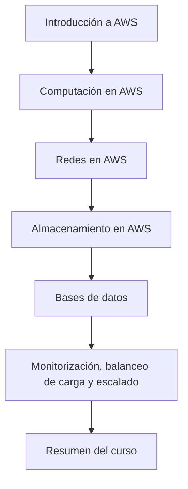

# Módulo 7: Resumen del curso

<!-- markdownlint-disable MD033 -->

  
  

<!-- markdownlint-enable MD033 -->

## Recorrido del curso

Durante AWS Technical Essentials se han explorado:

- Amazon Web Services, seguridad de AWS e IAM.
- Servidores virtuales, contenedores y computación sin servidor.
- Redes privadas y públicas de AWS, además de tráfico de red seguro.
- Opciones de almacenamiento en bloques, archivos y objetos.
- Servicios de bases de datos SQL y NoSQL.
- Monitorización, balanceo de carga y escalado de recursos.

## Aplicación final: Employee Directory sin servidor

La guía presenta una aplicación final denominada **Serverless Employee Directory** como referencia visual del curso.

## Continuar aprendiendo

La guía propone como siguientes cursos:

- Architecting on AWS.
- Developing on AWS.

También recomienda [AWS Skill Builder](https://skillbuilder.aws/) como centro de aprendizaje en línea de AWS.
Según el material, [AWS Skill Builder](https://skillbuilder.aws/) ofrece:

- Cursos digitales bajo demanda.
- Aprendizaje basado en juegos.
- Laboratorios a ritmo propio.
- Desafíos basados en casos de uso.
- Preparación para certificaciones.

## Oportunidades de aprendizaje

AWS Training and Certification propone:

- Formación digital gratuita y autoguiada sobre fundamentos de AWS.
- Formación presencial con instructores acreditados.
- Certificaciones reconocidas por la industria.

## Niveles de certificación de AWS

|Nivel|Descripción|
|---|---|
|Foundational|Certificación centrada en los conocimientos básicos de AWS Cloud.|
|Associate|Certificación basada en roles que valida conocimientos y habilidades.|
|Professional|Certificación basada en roles que valida habilidades avanzadas.|
|Specialty|Certificación centrada en ámbitos técnicos específicos.|

La guía indica estas recomendaciones de experiencia:

- **Professional:** dos años de experiencia diseñando, operando y resolviendo problemas de soluciones en AWS.
- **Associate:** un año resolviendo problemas e implementando soluciones en AWS.
- **Foundational:** seis meses de conocimientos básicos sobre AWS Cloud o experiencia en el sector.
- **Speciality:** experiencia técnica en el dominio indicado por la guía del examen.

Los exámenes y los temas evaluados pueden cambiar. La guía remite a las páginas oficiales de AWS Certification y a la guía de cada examen para consultar objetivos actualizados.

## Preparación para una certificación

La guía propone cuatro pasos:

1. Conocer el examen.
2. Estudiar los temas del examen.
3. Realizar formación de preparación.
4. Validar el nivel de preparación.

### Paso 1: Conocer el examen

- Revisar la guía del examen.
- Registrarse en [AWS Skill Builder](https://skillbuilder.aws/).
- Realizar un conjunto oficial de preguntas de practica.

Las preguntas de práctica incluyen comentarios detallados y recursos recomendados.

### Paso 2: Estudiar los temas

- Identificar carencias de conocimiento respecto a los temas del examen.
- Realizar cursos digitales autoguiados.
- Usar AWS Builder Labs para obtener experiencia práctica con los servicios de AWS.

### Paso 3: Formación de preparación

- Realizar cursos de [AWS Skill Builder](https://skillbuilder.aws/) para los dominios del examen.
- Utilizar AWS Builder Labs para trabajar con laboratorios autoguiados.
- Usar AWS Cloud Quest para practicar servicios de AWS mediante aprendizaje basados en juegos.

Algunos de estos recursos pueden requerir una suscripción digital.

### Paso 4: Validar la preparación

La guía recomienda realizar un examen oficial de práctica.

Estos exámenes:

- Tienen el mismo número de preguntas que el examen real..
- Utilizan un estilo, profundidad y exigencia similares.
- Incluyen una puntuación y un resultado de aprobado o no aprobado.
- Ofrecen comentarios sobre las opciones de respuesta.
- Recomiendan recursos para profundizar en los temas clave.

Se puede optar por simular el examen con tiempo limitado y respuestas visibles al final, o utilizar otras modalidades de práctica.

## Inscripción al examen

AWS ofrece opciones flexibles para realizar los exámenes de certificación. La guía recomienda consultar las opciones disponibles y seleccionar la que mejor se adapte a cada persona.

## Fin de AWS Technical Essentials

Con este módulo termina la guía teórica de AWS Technical Essentials.

---

!!! info "Acerca de este proyecto"
    - Esta documentación ha sido elaborada de forma independiente por **José Antonio Seguido Doblado** como material de estudio.
    - No constituye documentación oficial de Amazon Web Services (AWS).
