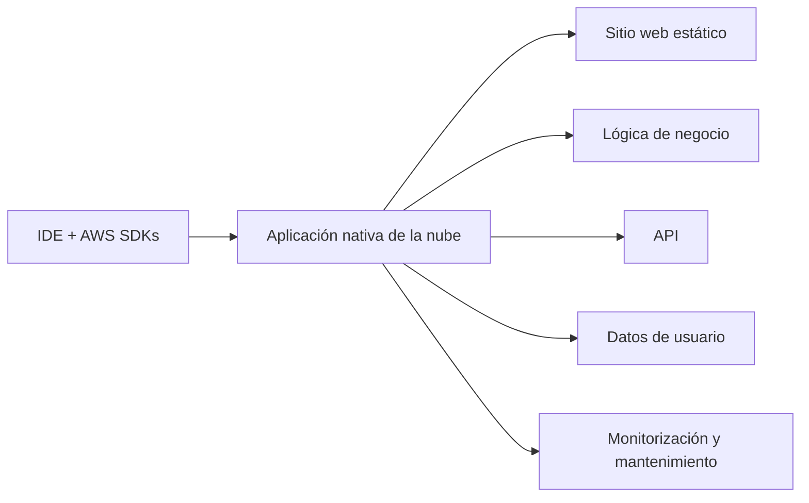

# Módulo 0: Descripción general del curso

<!-- markdownlint-disable MD033 -->

  
  

<!-- markdownlint-enable MD033 -->

Este curso se centra en desarrollar, desplegar, supervisar y mantener una aplicación nativa de la nube en AWS.

Como desarrollador, utilizarás entorno de desarrollo integrados, o IDE, junto con los AWS SDKs para crear la aplicación.
El itinerario cubre:

- Alojamiento de sitios web estáticos.
- Implementación de lógica de negocio.
- Gestión de API.
- Control de acceso a la aplicación.
- Almacenamiento y procesamiento de datos de usuario.
- Observación y mantenimiento de la aplicación.

## Objetivos del curso

Al finalizar el curso podrás:

- Configurar permisos de IAM para respaldar un entorno de desarrollo.
- Diseñar, diagramar, crear y desplegar una aplicación nativa de la nube mediante AWS SDKs.
- Supervisar y mantener una aplicación mediante recursos de AWS.

## Requisitos previos

La guía establece los siguientes conocimientos previos:

- AWS Cloud Practitioner Essentials.
- AWS Technical Essentials.
- Conocimientos básicos de un lenguaje de programación de alto nivel.

El curso propone trabajar con uno de estos lenguajes:

- Java.
- Python.
- C#.

## Organización del curso

El contenido se desarrollará siguiendo este orden de módulos:

1. [**Módulo 1: Creación de una aplicación web en AWS.**](modulos/01-creacion-de-una-aplicacion-web-en-aws.md)
2. [**Módulo 2: Introducción al desarrollo en AWS.**](modulos/02-introduccion-al-desarrollo-en-aws.md)
3. [**Módulo 3: Introducción a los permisos.**](modulos/03-introduccion-a-los-permisos.md)
4. **Módulo 4: Introducción al almacenamiento.**
5. **Módulo 5: Procesamiento de las operaciones de almacenamiento.**
6. **Módulo 6: Introducción a las bases de datos.**
7. **Módulo 7: Procesamiento de las operaciones de base de datos.**
8. **Módulo 8: Procesamiento de la lógica de la aplicación.**
9. **Módulo 9: Gestión de las API.**
10. **Módulo 10: Creación de una aplicación moderna.**
11. **Módulo 11: Concesión de acceso a la aplicación.**
12. **Módulo 12: Despliegue de la aplicación.**
13. **Módulo 13: Observación de la aplicación.**
14. **Módulo 14: Cierre del curso.**

---

!!! info "Acerca de este proyecto"
    - Esta documentación ha sido elaborada de forma independiente por **José Antonio Seguido Doblado** como material de estudio.
    - No constituye documentación oficial de Amazon Web Services (AWS).
