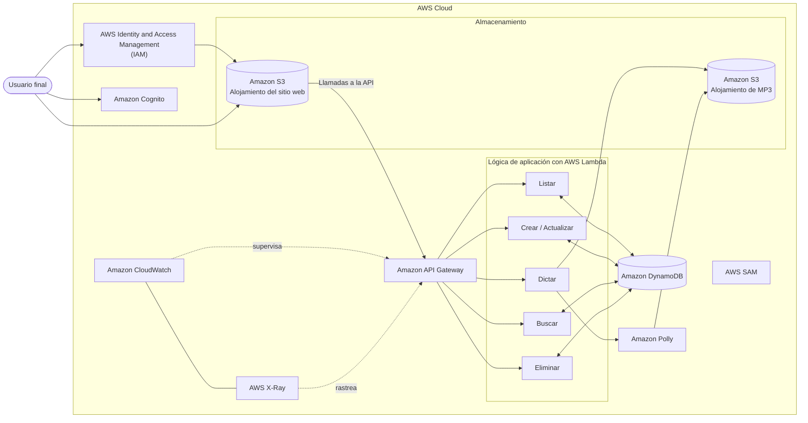

# Módulo 1: Creación de una aplicación web en AWS

<!-- markdownlint-disable MD033 -->

  
  

<!-- markdownlint-enable MD033 -->

## Objetivos del módulo

Al finalizar este módulo podrás:

- Describir la arquitectura de la aplicación que construirás durante el curso.
- Enumerar los servicios de AWS necesarios para crear la aplicación web.
- Determinar cómo almacenar, gestionar y alojar la aplicación.

## La aplicación: PollyNotes

La aplicación del curso permite a usuarios autorizados crear notas de texto personalizadas y convertirlas en audio mediante Amazon Polly.

Los usuarios acceden a un portal web en el que pueden realizar operaciones CRUD sobre sus notas de audio:

- Crear y actualizar notas.
- Buscar notas.
- Consultar las notas disponibles.
- Eliminar notas.

La aplicación se diseña como una solución nativa de la nube y basada en microservicios. Emplea Amazon API Gateway, AWS Lambda y Amazon DynamoDB, en lugar de depender de servidores que deban administrarse directamente.

Durante el desarrollo se utilizan AWS SDKs y otras herramientas de desarrollo, no la AWS Management Console como interfaz habitual de trabajo.

## Herramientas de desarrollo

Un desarrollador interactúa con los recursos de AWS desde un entorno de desarrollo integrado (IDE), mediante AWS SDKs y toolkits.

AWS Identity and Access Management (IAM) permite administrar de forma segura el acceso a dichos recursos. Al configurar correctamente la identidad y los permisos del entorno de desarrollo, los SDKs pueden invocar los servicios de AWS necesarios para construir la aplicación.
También se trabajará con roles de IAM y perfiles de seguridad adecuados para el ciclo de vida del desarrollo.

## Almacenamiento y alojamiento de la aplicación

Amazon Simple Storage Service (Amazon S3) cubre dos necesidades principales de PollyNotes:

- Alojar el sitio web que actúa como interfaz de usuario o front-end.
- Almacenar los archivos MP3 que genera Amazon Polly.

Los buckets de Amazon S3 se integran con los componentes de computación para permitir las operaciones CRUD de la aplicación.

## Gestión de los datos de usuario

Amazon DynamoDB almacena las notas de los usuarios y sus interacciones con la aplicación.
Es una base de datos NoSQL totalmente administrada, sin servidores y escalable. Su capacidad puede adaptarse a cambios en la demanda de la aplicación sin que sea necesario instalar ni administrar software de base de datos.

## Procesamiento de los datos

AWS Lambda implementa la lógica de negocio de las operaciones CRUD.
Aunque una instancia de Amazon EC2 podría cubrir las necesidades de cómputo, requeriría supervisión y mantenimiento continuos. En su lugar, varias funciones de Lambda ofrecen una solución sin servidores que escala según la carga de trabajo y se configura desde el entorno de desarrollo.

## Conexión de los componentes

Amazon API Gateway conecta los servicios de la aplicación.
Recibe las solicitudes dirigidas a la API, las enruta hacia los componentes correspondientes y devuelve la respuesta al usuario. También facilita la creación, publicación, mantenimiento, supervisión y protección de la API.

## Acceso de los usuarios

Amazon Cognito proporciona autenticación y autorización para los usuarios de la aplicación.
Sus dos componentes principales son:

- **User pools:** directorios de usuarios que ofrecen funcionalidades integradas de registro e inicio de sesión.
- **Identity pools:** permiten conceder a los usuarios acceso a otros servicios de AWS.

Pueden utilizarse de forma independiente o combinada, según las necesidades de control de acceso de la aplicación.

## Observabilidad de la aplicación

Amazon CloudWatch aporta información práctica para supervisar y solucionar problemas de la aplicación.
AWS X-Ray ayuda a analizar y depurar la aplicación distribuida, especialmente cuando hay errores o problemas de rendimiento. Ambos servicios permiten observar las interacciones entre los componentes y detectar incidencias tras cambios futuros.

## Arquitectura de PollyNotes

Esta arquitectura será la referencia del resto del curso: cada módulo profundizará en uno o varios de sus componentes.

---

!!! info "Acerca de este proyecto"
    - Esta documentación ha sido elaborada de forma independiente por **José Antonio Seguido Doblado** como material de estudio.
    - No constituye documentación oficial de Amazon Web Services (AWS).
