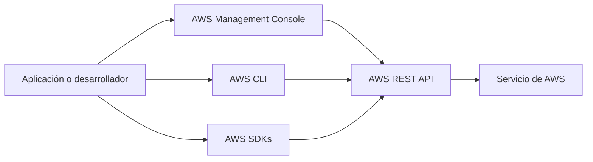
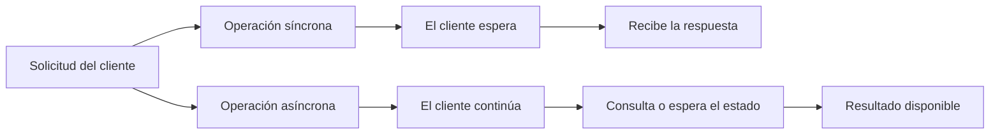
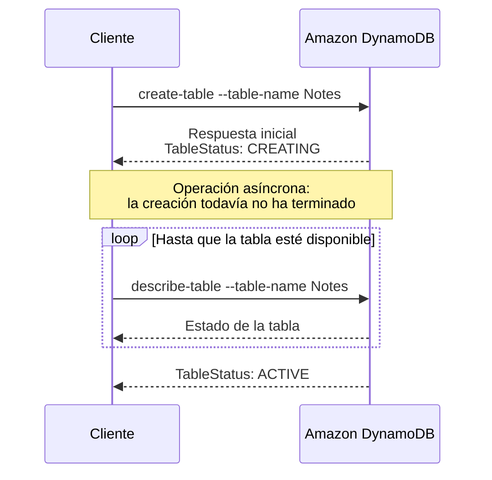
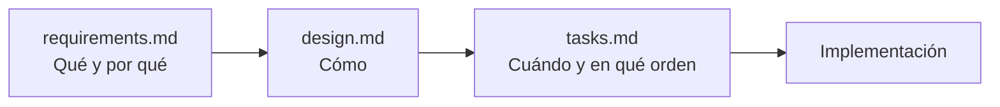

# Módulo 2: Introducción al desarrollo en AWS

<!-- markdownlint-disable MD033 -->
<p align="center">
  
  
</p>
<!-- markdownlint-enable MD033 -->

## Objetivos del módulo

Al finalizar este módulo podrás:

- Describir cómo acceder a los servicios de AWS mediante programación.
- Enumerar patrones de programación disponibles en los AWS SDKs.

## Acceso programático a los servicios de AWS

Todos los servicios de AWS exponen sus capacidades mediante una API específica. Para conectar mediante programación con un servicio se utiliza su endpoint, es decir, la URL que actúa como punto de entrada a su API.
Por seguridad, la mayoría de las solicitudes se firman con credenciales de acceso compuestas por un identificador de clave de acceso y una clave de acceso secreta. AWS utiliza Signature Version 4 (SigV4) para añadir la información de autenticación mediante valores hash y marcas de tiempo.

### Solicitudes y respuestas HTTP

Una API proporciona un mecanismo estándar de comunicación entre un cliente y un servicio.
Tanto la solicitud como la respuesta HTTP contienen:

- Una línea inicial.
- Cabeceras opcionales con metadatos.
- Un cuerpo o _payload_ opcional con el contenido transmitido.

En una solicitud, la línea inicial indica la acción y la ruta del recurso. En una respuesta, indica el resultado de la operación mediante un código de estado.
Las cabeceras pueden aplicarse a ambos mensajes, solo a la solicitud, solo a la respuesta o al recurso. Por ejemplo, pueden indicar la fecha, el host, el identificador de solicitud o el tipo de contenido.

### Códigos de estado HTTP

| Grupo | Significado                                                                           |
| ----- | ------------------------------------------------------------------------------------- |
| `1xx` | Respuesta informativa: todo va correctamente hasta ese punto.                         |
| `2xx` | Éxito: el servicio recibió y procesó correctamente la solicitud.                      |
| `3xx` | Redirección: se requiere una acción adicional para completar la solicitud.            |
| `4xx` | Error del cliente, por ejemplo una sintaxis incorrecta o una solicitud no válida.     |
| `5xx` | Error del servidor que impide completar una solicitud que, aparentemente, era válida. |

### Formas de acceder a AWS

Puedes utilizar las distintas modalidades de acceso de forma intercambiable:



- **API directamente:** ofrece control completo, pero obliga a construir solicitudes, firmarlas, interpretar respuestas y gestionar errores específicos de cada servicio.
- **AWS SDKs:** simplifican el acceso programático desde lenguajes de programación conocidos.
- **AWS Management Console:** proporciona una interfaz gráfica para gran parte de las funcionalidades de AWS; sin embargo, el acceso programático suele resultar más eficiente para el desarrollo y la automatización.
- **AWS Command Line Interface (AWS CLI):** permite administrar servicios desde una terminal y automatizar acciones mediante scripts.

---

## AWS SDKs

Los AWS SDKs permiten usar espacios de AWS desde el lenguaje de programación de una aplicación. Hay SDKs disponibles, entre otros, para Python, .NET, Java, JavaScript, Node.js, Go, Ruby, PHP, C++, Swift, Rust y Kotlin.
Por ejemplo, una aplicación de intercambio de música puede utilizar un SDK para cargar los archivos del usuario en un bucket de Amazon S3.

### Ventajas de los SDKs

Los SDKs aportan funcionalidades que evitan implementar repetidamente lógica de bajo nivel:

- Integración con el lenguaje de programación elegido.
- Firma automática de las solicitudes HTTP.
- Gestión integrada de reintentos, errores y tiempos de espera.
- Resiliencia incorporada.
- Compatibilidad con paginación.

La paginación permite recuperar resultados en varias solicitudes sin tener que desarrollar manualmente la lógica de tokens de continuación, bucles y llamadas sucesivas.

### API de bajo nivel y API de alto nivel

Los SDKs pueden ofrecer dos niveles de abstracción:

| API de bajo nivel                                                   | API de alto nivel                                              |
| ------------------------------------------------------------------- | -------------------------------------------------------------- |
| Normalmente proporciona un método por cada operación del servicio.  | Normalmente proporciona una clase por cada recurso conceptual. |
| Ofrece control detallado sobre las solicitudes y su comportamiento. | Simplifica el uso de recursos y operaciones habituales.        |
| En Python se corresponde con una API de cliente de servicio.        | En Python se corresponde con una API de recursos.              |

Si la API de alto nivel incluye la operación necesaria, suele ser preferible por su simplicidad. Por ejemplo, al cargar un archivo en Amazon S3, puede decidir automáticamente si realizar una carga única o multipart según el tamaño del archivo.

#### Ejemplo: conexión a Amazon S3 mediante API

```python title="API de bajo nivel: listar objetos de un bucket"
# El tipo de retorno es un diccionario.
# Se necesitan llamadas adicionales a la API para obtener los objetos.
def list_client():
    s3_client = boto3.client("s3")

    response = s3_client.list_objects_v2(Bucket="mybucket")
    for content in response["Contents"]:
        print(content["Key"], content["LastModified"])
```

---

```python title="API de alto nivel: listar objetos de un bucket"
# Los recursos proporcionan una interfaz orientada a objetos para AWS.
# Ofrecen una abstracción de más alto nivel que las llamadas de bajo
# nivel realizadas por los clientes de servicio.
def list_resource():
    s3_resource = boto3.resource("s3")
    bucket = s3_resource.Bucket("mybucket")

    for object in bucket.objects.all():
        print(object.key, object.last_modified)
```

---

## AWS Command Line Interface (AWS CLI)

AWS CLI permite invocar servicios de AWS desde una terminal.
Puede utilizarse:

- Localmente, desde shells de Linux o macOS, y desde la línea de comandos o PowerShell en Windows.
- De forma remota, en instancias de Amazon EC2 mediante SSH, con AWS CloudShell o con AWS System Manager Session Manager.

La configuración inicial puede establecer credenciales y una región predeterminada para los comandos. La estructura básica de un comando es:

```shell title="Estructura básica de un comando AWS CLI"
aws <servicio> <subcomando> <parámetros> <opciones>
```

---

Ejemplo conceptual:

```shell title="Ejemplo de comando AWS CLI"
aws s3 ls s3://mi-bucket --recursive
```

En este caso:

- `aws` es el comando base.
- `s3` identifica el servicio.
- `ls` es el subcomando u operación.
- `s3://mi-bucket` es el objetivo.
- `-- recursive` es una opción.

La ayuda está disponible en varios niveles, por ejemplo con `aws help`, `aws s3 help` o `aws s3 ls help`.

---

## Operaciones y patrones de programación

### Operaciones síncronas y asíncronas

Una operación puede ejecutarse de dos formas:



- **Síncrona o bloqueante:** el cliente realiza la solicitud y espera la respuesta antes de continuar.
- **Asíncrona o no bloqueante:** el cliente realiza la solicitud, recupera el control antes de que el servicio responda y puede continuar con otras tareas.

En una operación asíncrona, la aplicación debe obtener posteriormente el resultado o determinar si la solicitud ha fallado.



### Sondeo y _waiters_

Algunos recursos requieren tiempo para alcanzar un estado operativo. Por ejemplo, una tabla de Amazon DynamoDB pueden necesitar pasar al estado `ACTIVE` antes de poder utilizarse.

El sondeo consulta periódicamente el estado del recurso. Los _waiters_ abstraen esa lógica: consultan el recurso hasta que alcanza el estado esperado o hasta que se produce un error.
Los _waiters_ pueden configurarse con un número máximo de intentos y una estrategia de espera entre ellos.

```C# title="Ejemplo: sondeo manual del estado de una tabla en .NET"
// Crea una tabla con información de solicitud, como su nombre.
var response = client.CreateTable(request);
var tableDescription = response.TableDescription;

// Estado inicial de la tabla.
status = tableDescription.TableStatus;

while (status != "ACTIVE")
{
    // Cuando se crea, el estado de la tabla se establece como ACTIVE.
    System.Threading.Thread.Sleep(5000); // Espera 5 segundos.

    // Obtiene la información más reciente de la tabla.
    var response = client.DescribeTable(
        new DescribeTableRequest { TableName = tableName }
    );

    Console.WriteLine(
        "Nombre de tabla: {0}, estado: {1}",
        response.Table.TableName,
        response.Table.TableStatus
    );

    status = response.Table.TableStatus;
}
```

---

```python title="Ejemplo: waiter en Python"
# Crea una tabla y espera hasta que esté disponible.

# Obtiene el recurso del servicio.
dynamodb = boto3.resource("dynamodb")

# Crea la tabla de DynamoDB.
table = dynamodb.create_table(
    TableName="Notes",
    ...
)

# Espera hasta que la tabla exista.
table.meta.client.get_waiter("table_exists").wait(
    TableName="Notes"
)

# Muestra datos de la tabla.
print(table.item_count)
```

---

```java title="Ejemplo: sondeo con waiters en Java"
// Crea un waiter que espera la creación correcta de una tabla.
Waiter waiter = client.waiters().tableExists();

try {
    waiter.run(
        new WaiterParameters<>(
            new DescribeTableRequest(tableName)
        )
    );
} catch (WaiterUnrecoverableException e) {
    // Finaliza si el recurso entra en un estado no deseado.
} catch (WaiterTimedOutException e) {
    // No alcanzó el estado deseado después del sondeo.
} catch (DynamoDbException e) {
    // Excepción inesperada del servicio.
}
```

### Errores y reintentos

Los errores de AWS se interpretan, en primer lugar, mediante sus códigos de estado:

- Los errores `4xx` suelen requerir que la aplicación gestione el problema de la solicitud.
- Los errores `5xx` indican un problema interno del servicio y pueden justificar un reintento.

Los AWS SDKs incluyen lógica automática de reintentos, configurable según el número máximo de intentos.
Cada SDK comunica los errores según las convenciones de su lenguaje. Por ejemplo:

- Java y .NET emplean excepciones de servicio y de cliente.
- Boto3, el SDK de Python, utiliza `botocore.exceptions.ClientError`.

## Observabilidad de la aplicación

La aplicación debe ser observable para detectar problemas, analizar su comportamiento y facilitar la resolución de incidencias.

Amazon CloudWatch puede recopilar, agregar y resumir métricas de uso de recursos, como CPU, memoria, disco y red, además de registros y datos de diagnóstico.

AWS X-Ray proporciona una visión de extremo a extremo de las solicitudes de una aplicación distribuida. Reúne los datos de los servicios implicados en una traza y permite visualizar el recorrido de una solicitud a través de las distintas capas de la aplicación.

## Entornos de desarrollo integrados

Un entorno de desarrollo integrado (IDE) permite escribir, ejecutar y depurar código desde una única aplicación.
Puede mejorar la productividad mediante resaltado de sintaxis, autocompletado, intérpretes, herramientas de depuración y otras ayudas.
Los IDE pueden instalarse localmente o utilizarse desde la nube. Un IDE basado en la nube permite:

- Acceder al entorno desde cualquier sistema operativo mediante un navegador.
- Utilizar capacidad de cómputo superior a la del equipo local.
- Aprovisionar rápidamente entornos preconfigurados para proyectos o integrantes nuevos.
- Colaborar simultáneamente sobre el mismo código.
- Utilizar SDKs de la plataforma.

Los AWS Toolkits facilitan la creación, depuración y despliegue de aplicaciones desde IDEs compatibles.

### Kiro: IDE con IA y desarrollo guiado por especificaciones

Kiro es un IDE basado en IA, construido sobre Code-OSS, que propone un enfoque de desarrollo guiado por especificaciones. Su propósito no es únicamente generar código, sino coordinar el ciclo completo de un proyecto: desde los requisitos hasta el despliegue.

#### Desarrollo guiado por especificaciones

Este enfoque relaciona los requisitos del producto con los detalles técnicos de implementación mediante tres archivos principales:



- `requirements.md`: recoge los objetivos de negocio y los criterios de éxito.
- `design.md`: define la arquitectura técnica que guía las decisiones de implementación.
- `tasks.md`: divide la implementación en tareas ordenadas.

Esta estructura aporta el contexto y el marco de decisión necesarios para que agentes de IA trabajen de manera coherente en tareas complejas.

#### Capacidades principales

- **Dirección de agentes:** archivos de configuración que orientan el comportamiento y las decisiones del agente según el proyecto.
- **Dos modos de funcionamiento:**
  - _Autopilot:_ el agente puede implementar funcionalidades de forma autónoma.
  - _Supervised:_ mantiene la supervisión humana sobre las decisiones importantes.
- **Model Context Protocol (MCP):** estándar abierto para conectar modelos de IA con fuentes de datos, herramientas y sistemas externos.
- **Procesamiento de contexto multimodal:** uso de archivos, documentación y salidas de terminal para aportar al agente una visión más completa de la base de código.

---

## Cuestionario de conocimientos

<!-- markdownlint-disable MD033 -->
<quiz>
**Las API de clientes de servicio proporcionan una abstracción de nivel superior de las llamadas de bajo nivel realizadas por las API de recursos.**

- [ ] Verdadero.
- [x] Falso.

_Las API de recursos son las que ofrecen una abstracción de más alto nivel. Las API de clientes de servicio son las de bajo nivel y se corresponden más directamente con las operaciones de cada servicio._
</quiz>

<quiz>
**Amazon CloudWatch puede supervisar datos como CPU, disco, E/S y red.**

- [x] Verdadero.
- [ ] Falso.

_CloudWatch recopila y agrega métricas de utilización y datos de diagnóstico de la aplicación y su infraestructura._
</quiz>

<quiz>
**Cada AWS SDK implementa lógica de reintento automático.**

- [x] Verdadero.
- [ ] Falso.

_Los SDKs incorporan reintentos y mecanismos de resiliencia para evitar que cada aplicación tenga que implementarlos desde cero._
</quiz>

<quiz>
**Un error de la serie `500` indica que el servidor no puede procesar una solicitud por una sintaxis no válida enviada por el cliente.**

- [ ] Verdadero.
- [x] Falso.

_La sintaxis incorrecta corresponde normalmente a un error `4xx` del cliente; los códigos `5xx` indican errores internos del servidor._
</quiz>

<quiz>
**Los recursos de AWS se pueden administrar mediante APIs, SDKs, AWS CLI o AWS Management Console.**

- [x] Verdadero.
- [ ] Falso.

_Son modalidades de acceso diferentes que pueden utilizarse según el contexto y la necesidad de automatización._
</quiz>

<quiz>
**Las llamadas a servicios de AWS incluyen información de autorización.**

- [x] Verdadero.
- [ ] Falso.

_La mayoría de solicitudes requieren autenticación y se firman, por ejemplo, mediante SigV4 y credenciales de acceso._
</quiz>
<!-- markdownlint-enable MD033 -->

---

!!! info "Acerca de este proyecto"
    - Esta documentación ha sido elaborada de forma independiente por **José Antonio Seguido Doblado** como material de estudio.
    - No constituye documentación oficial de Amazon Web Services (AWS).
