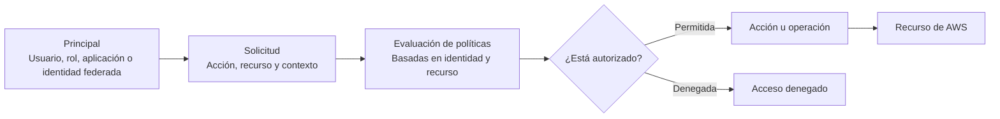
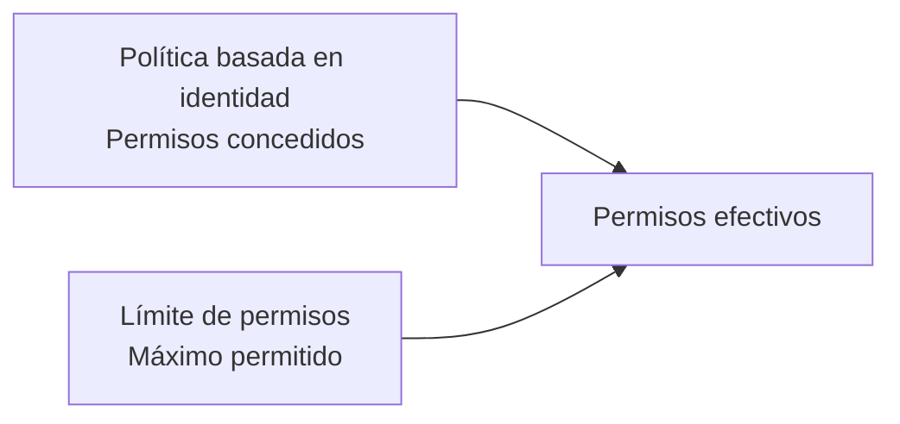
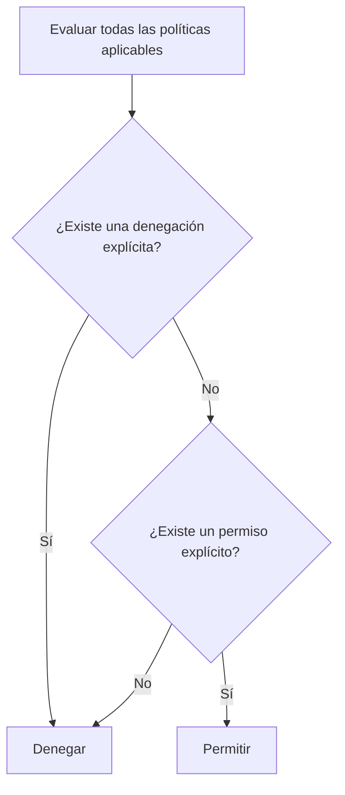

# Módulo 3: Introducción a los permisos

<!-- markdownlint-disable MD033 -->
<p align="center">
  
  
</p>
<!-- markdownlint-enable MD033 -->

## Objetivos del módulo

Al finalizar este módulo podrás:

- Identificar las características y los componentes de AWS Identity and Access Management (IAM).
- Configurar permisos para un entorno de desarrollo.
- Probar permisos de IAM.
- Configurar IDEs y SDKs para un entorno de desarrollo.
- Acceder a servicios de AWS mediante SDKs.

## Repaso de IAM

AWS Identity and Access Management (IAM) permite controlar de forma segura el acceso a los recursos de AWS.

- **Autenticación:** determina quién puede usar los recursos.
- **Autorización:** determina cómo puede usarlos esa identidad.

Una aplicación requiere permisos para las personas que la desarrollan o administran, para el entorno de desarrollo y para los recursos de AWS. IAM también permite configurar el entorno para acceder de forma eficiente a varias cuentas de AWS.

## Términos y conceptos de IAM

- **Usuarios:** personas o aplicaciones representadas como identidades de AWS.
- **Grupos de usuarios:** colecciones de usuarios, normalmente organizadas por función, como desarrollo, administración o DevOps.
- **Políticas:** documentos que definen que acciones están permitidas o denegadas.
- Roles: identidades asumibles por entidades de confianza. No poseen credenciales a largo plazo; proporcionan credenciales temporales durante una sesión.

Un usuario de IAM puede asumir un rol y obtener las credenciales temporales asociadas a él.

## Funcionamiento de IAM



### Principal

Es la persona o aplicación que utiliza una identidad para iniciar sesión o realizar solicitudes a AWS. Puede ser el usuario raíz, un usuario de IAM, un rol o un usuario federado.

### Solicitud

Cuando un principal usa la AWS Management Console, una API, AWS CLI o un SDK, envía una solicitud que contiene:

- La acción u operación que desea realizar.
- El recurso sobre el que se realizará.
- El principal que la solicita.
- Datos de entorno, como dirección IP, agente de usuario, uso de SSL u hora.
- Datos relativos al recurso.

AWS combina esa información en un contexto de solicitud para evaluarla.

### Autorización

AWS comprueba las políticas aplicables para determinar si permite o deniega la solicitud. Los dos tipos más habituales son:

- **Políticas basadas en identidad:** se adjuntan a usuarios, grupos o roles de IAM y definen lo que esa identidad puede hacer.
- **Políticas basadas en recursos:** se adjuntan al propio recurso, como un bucket de Amazon S3. Son habituales para conceder acceso entre cuentas.

Una vez autenticada y autorizada una solicitud, AWS puede ejecutar la operación sobre el recurso correspondiente..

#### Políticas basadas en identidad

Las políticas basadas en identidad se adjuntan directamente a un usuario, grupo o rol. Un usuario puede recibirlas directamente, aunque asignarlas a un grupo suele ser la opción recomendada.
Este ejemplo, permite enumerar un bucket llamado `notes` y realizar operaciones sobre sus objetos:

```json title="Política basada en identidad"
{
  "Version": "2012-10-17",
  "Id": "s3PolicyId1",
  "Statement": [
    {
      "Sid": "ListObjectsInBucket",
      "Effect": "Allow",
      "Action": "s3:ListBucket",
      "Resource": "arn:aws:s3:::notes"
    },
    {
      "Sid": "AllowObjectActions",
      "Effect": "Allow",
      "Action": "s3:*Object*",
      "Resource": [
        "arn:aws:s3:::notes/*"
      ]
    }
  ]
}
```

#### Políticas basadas en recursos

Estas políticas se adjuntan a un recurso de AWS. Indican qué principal puede realizar acciones concretas sobre él y en qué condiciones.
El siguiente ejemplo deniega todas las operaciones de Amazon S3 sobre el bucket `notes`, salvo cuando la solicitud procede del intervalo de direcciones IP especificados:

```json title="Política basada en recurso"
{
  "Version": "2012-10-17",
  "Id": "s3PolicyId1",
  "Statement": [
    {
      "Sid": "IPAllow",
      "Effect": "Deny",
      "Principal": "*",
      "Action": "s3:*",
      "Resource": [
        "arn:aws:s3:::notes",
        "arn:aws:s3:::notes/*"
      ],
      "Condition": {
        "NotIpAddress": {
          "aws:SourceIp": "54.240.143.0/24"
        }
      }
    }
  ]
}
```

## Límites de permisos

Un límite de permisos es una característica avanzada de IAM que define el máximo de permisos que una política basada en identidad puede conceder a un usuario o rol.
Los permisos efectivos de una entidad son la intersección entre:

- Lo permitido por sus políticas basadas en identidad.
- Lo permitido por su límite de permisos.



Por ejemplo, un grupo puede tener la política administrada `PowerUserAccess`, pero un miembro concreto puede estar limitado a Amazon CloudWatch. Aunque el grupo permita acciones sobre Amazon S3, ese usuario no podrá realizarlas si Amazon S3 queda fuera de su límite de permisos.

## Roles de IAM

Los roles permiten delegar acceso temporalmente a usuarios, aplicaciones o servicios que normalmente no disponen de estos permisos.
Un rol:

- No tiene contraseña ni claves de acceso permanentes.
- Puede ser asumido por distintas entidades de confianza.
- Proporciona permisos temporales durante una sesión.
- Es útil para el acceso entre cuentas, identidades externas y servicios de AWS.

### Ejemplos de uso

- Un usuario perteneciente a un grupo puede asumir temporalmente un rol de administrador de base de datos para escribir en una tabla.
- Un usuario de una cuenta de desarrollo puede cambiar a un rol de cuenta de producción y obtener credenciales temporales para realizar cambios autorizados.
- Una función de AWS Lambda puede asumir un rol de servicio para actuar sobre una tabla de Amazon DynamoDB.

## Lógica de evaluación de políticas

IAM evalúa todas las políticas aplicables a una solicitud.



Las reglas fundamentales son:

1. Toda solicitud se deniega de forma predeterminada.
2. Un permiso explícito puede superar esa denegación implícita.
3. Una denegación explícita prevalece siempre sobre cualquier permiso.
4. El orden en que se evalúan las políticas no altera el resultado.

Como práctica recomendada, aplica políticas a grupos y sigue el principio de privilegio mínimo: concede solo los permisos necesarios.

## Comprobación de permisos

La guía presenta dos demostraciones para verificar cómo se aplican los permisos.

### Límite de permisos

Un usuario con la política `PowerUserAccess` intenta crear un bucket de Amazon S3:

<!-- cSpell:disable -->
```shell title="Crear un bucket S3"
aws s3 mb s3://bucketfordevonawsdemo05122021 \
  --profile userwithpermissionboundary
```
<!-- cSpell:enable -->

El intento falla porque su límite de permisos no incluye Amazon S3. Un usuario con permisos administrativos puede sustituir el límite por otro que sí permita S3:

<!-- cSpell:disable -->
```shell title="Aumentar límite de permisos"
aws iam put-user-permissions-boundary \
  --permissions-boundary arn:aws:iam::111122223333:policy/S3elevated \
  --user-name userwithpermissionboundary \
  --profile userwithiamaccess
```
<!-- cSpell:enable -->

Después, el mismo usuario puede volver a intentar la creación del bucket.

### Asunción de un rol

Un usuario con acceso a AWS CloudShell, pero sin permisos para crear buckets, puede asumir un rol que sí los posee:

```shell title="Asumir un rol AWS"
aws sts assume-role \
  --role-arn "arn:aws:iam::111122223333:role/S3access" \
  --role-session-name DevOnAWS
```

<!-- cSpell:disable-next-line -->
La respuesta contiene `AccessKeyId`, `SecretAccessey` y `SessionToken`. Esas credenciales temporales se configuran en el entorno:

```shell title="Respuesta al asumir rol AWS"
export AWS_ACCESS_KEY_ID=...
export AWS_SECRET_ACCESS_KEY=...
export AWS_SESSION_TOKEN=...
```

Después se puede confirmar la identidad activa:

```shell title="Confirmar identidad AWS activa"
aws sts get-caller-identity
```

Y realizar la operación permitida por el rol:

```shell title="Crear un bucket S3"
aws s3 mb s3://DevonAWStest_bucket
```

## Diseño de autenticación y autorización

Al diseñar el acceso a una aplicación, conviene responder a estas preguntas:

- ¿Qué personas, aplicaciones o servicios necesitan acceso?
- ¿Qué nivel de acceso requieren?
- ¿Qué roles beneficiarían a la aplicación?
- ¿Necesita acceso alguna entidad externa?
- ¿Todos necesitan acceso completo a todos los servicios en todo momento?

La respuesta debe guiar la definición de usuarios, grupos, roles, políticas y credenciales.

## Configuración del entorno de desarrollo

### Credenciales permanentes

El comando `aws configure` solicita:

- El identificador de clave de acceso.
- La clave de acceso secreta.
- La región predeterminada.
- El formato de salida, como `json`, `yaml` o `text`.

```shell title="Configurar AWS CLI"
aws configure
```

En Linux, macOS o Unix, los archivos habituales son:

```text title="Archivos habituales AWS en Linux, Unix o macOs"
~/.aws/config
~/.aws/credentials
```

En Windows:

```text title="Archivos habituales AWS en Windows"
C:\Users\USERNAME\.aws\config
C:\Users\USERNAME\.aws\credentials
```

### Perfiles con nombre

Los perfiles con nombre agrupan configuración y credenciales. Permiten cambiar entre cuentas, usuarios, roles y regiones desde AWS CLI o desde IDEs compatibles.

```shell title="Comando con perfil predeterminado"
aws s3 mb s3://mybucket
```

El comando anterior usar el perfil predeterminado. Para utilizar otro perfil:

```shell title="Comando con perfil específico"
aws s3 mb s3://mybucket --profile user1
```

Para crear o modificar un perfil:

```shell title="Crear o modificar perfil AWS"
aws configure --profile user1
```

### Configuración, variables de entorno y prioridad

Los archivos de configuración y credenciales pueden incluir ajustes globales, ajustes específicos de servicios y perfiles.
También pueden definirse variables de entorno para configurar temporalmente una aplicación o una herramienta.
En general, los SDKs y las herramientas buscan credenciales y configuración en este orden:

1. Parámetros indicados directamente en el código o en AWS CLI.
2. Variables de entorno.
3. Archivo compartido de credenciales.
4. Archivo de configuración.
5. Perfil de instancia.

Para credenciales, una prioridad típica es:

1. Credenciales especificadas en código o en un comando de AWS CLI.
2. Variables como `AWS_ACCESS_KEY_ID` y `AWS_SECRET_ACCESS_KEY`.
3. Perfil predeterminado del archivo de credenciales.
4. Perfil de instancia asociado a una instancia de Amazon EC2.

## Firma de solicitudes

Signature Version 4 (SigV4) añade información de autenticación a las solicitudes HTTP dirigidas a las API de AWS.
La firma:

- Verifica la identidad del solicitante.
- Protege los datos durante el tránsito.
- Ayuda a evitar ataques de repetición.

La información de autorización puede viajar en la cabecera HTTP `Authorization` o en los parámetros de consulta.
Los AWS SDKs y AWS CLI firman automáticamente las solicitudes con las credenciales configuradas.
El uso de HTTPS cifra la transmisión. No es necesario firmar manualmente solicitudes realizadas mediante un SDK, AWS CLI o una CLI específica de un servicio.

## Credenciales temporales

AWS Security Token Service (AWS STS) permite solicitar credenciales temporales y de permisos limitados.
Estas credenciales:

- Son de corta duración.
- Constituyen la base de los roles.
- No se almacenan permanentemente junto al solicitante.
- No se reutilizan después de caducar.
- Pueden emplearse en federación de identidades web.

La federación permite que usuarios de proveedores de identidad externos, como Amazon, Facebook, Google u otros proveedores compatibles con OpenID Connect (OIDC), accedan a recursos de AWS sin crear una identidad de IAM permanente.
Entre sus ventajas están evitar distribuir credenciales de larga duración, proporcionar acceso a usuarios externos y eliminar la necesidad de rotar o revocar credenciales una vez que han caducado.

## Consideraciones para el IDE

- En Java, la JVM almacena en caché las consultas DNS; se recomienda configurar un TTL inferior a 60 segundos.
- Las variables de entorno pueden servir para configurar credenciales, ajustes u otro perfil temporalmente.
- Los SDKs implementan reintentos y _exponential backoff_: cada reintento sucesivo espera más tiempo para mejorar el control de flujo entre errores de red o de servicios.

---

## Cuestionario de conocimiento

<!-- markdownlint-disable MD033 -->
<quiz>
**Los límites de permisos establecen los permisos mínimos que una política basada en identidad puede conceder a un usuario o rol.**

- [ ] Verdadero.
- [x] Falso.

_Establecen los permisos máximos que puede conceder una política basada en identidad._
</quiz>

<quiz>
**Los roles de IAM delegan temporalmente acceso a usuarios o servicios que normalmente no lo tienen.**

- [x] Verdadero.
- [ ] Falso.

_Un rol proporciona permisos y credenciales temporales a una entidad autorizada para asumirlo._
</quiz>

<quiz>
**Las políticas basadas en identidad conceden a un principal permisos para realizar acciones sobre un recurso y definen las condiciones aplicables.**

- [ ] Verdadero.
- [x] Falso.

_Esa definición corresponde a una política basada en recursos; las políticas basadas en identidad se adjuntan a usuarios, grupos o roles._
</quiz>

<quiz>
**AWS CLI admite varios perfiles con nombre para interactuar con recursos de AWS.**

- [x] Verdadero.
- [ ] Falso.

_Los perfiles permiten alternar entre distintas cuentas, usuarios, roles y regiones._
</quiz>

<quiz>
**Cuando caducan las credenciales temporales, no es necesario rotarlas ni revocarlas explícitamente.**

- [x] Verdadero.
- [ ] Falso.

_Una vez expiradas no pueden reutilizarse._
</quiz>

<quiz>
**Los archivos de configuración y credenciales pueden incluir ajustes definidos mediante variables de entorno del sistema.**

- [x] Verdadero.
- [ ] Falso.

_Las herramientas y SDKs pueden obtener configuración y credenciales desde variables de entorno, además de archivos locales._
</quiz>
<!-- markdownlint-enable MD033 -->

---

!!! info "Acerca de este proyecto"
    - Esta documentación ha sido elaborada de forma independiente por **José Antonio Seguido Doblado** como material de estudio.
    - No constituye documentación oficial de Amazon Web Services (AWS).
