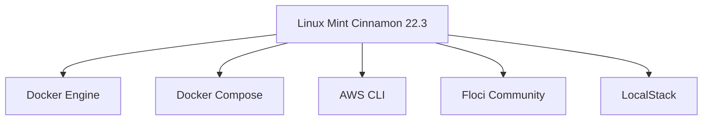

# Módulo 0: Preparación del entorno

<!-- markdownlint-disable MD033 -->
<p align="center">
  
  
</p>
<!-- markdownlint-enable MD033 -->

## Sistema operativo

El entorno de laboratorios se ejecutará dentro de una máquina virtual con:

- Linux Mint Cinnamon 22.3.
- Base Ubuntu 24.04 Noble.
- Arquitectura x86_64.
- Conexión a Internet.
- Usuarios con permisos `sudo`.

La máquina virtual alojará todas las herramientas del entorno:



<!-- markdownlint-disable MD033 -->
<!-- cSpell:disable-next-line -->

<!-- markdownlint-enable MD033 -->

## Actualizar el sistema

Antes de instalar cualquier herramienta, actualiza la información de paquetes:

```shell title="Actualizar información paquetes AWS Labs"
sudo apt-get update
```

Instalar las actualizaciones disponibles:

```shell title="Instalar actualizaciones disponibles AWS Labs"
sudo apt-get upgrade -y
```

Reinicia la VM si el sistema lo solicita:

```shell title="Reiniciar sistema"
sudo reboot
```

## Comprobar la distribución

Después de reiniciar, verifica la versión de Linux:

```shell title="Verificar versión Linux"
cat /etc/os-release
```

La salida debe indicar:

```shell title="Salida correcta verificar versión Linux"
NAME="Linux Mint"
VERSION="22.3 (Zena)"
ID=linuxmint
UBUNTU_CODENAME=noble
```

Ejemplo:

<!-- markdownlint-disable MD033 -->
<!-- cSpell:disable-next-line -->

<!-- markdownlint-enable MD033 -->
También comprueba la arquitectura:

```shell title="Comprobar arquitectura"
uname -m
```

Para este entorno se espera:

```shell title="Arquitectura correcta entorno AWS Labs"
x86_64
```

Ejemplo:

<!-- markdownlint-disable MD033 -->
<!-- cSpell:disable-next-line -->

<!-- markdownlint-enable MD033 -->

---

!!!success "Resultado"
    La máquina virtual está preparada como base aislada para instalar Docker, AWS CLI, Floci y LocalStack.

---

Máquina virtual base preparada:

<!-- markdownlint-disable MD033 -->
<!-- cSpell:disable-next-line -->

<!-- markdownlint-enable MD033 -->

---

!!! info "Acerca de este proyecto"
    - Esta documentación ha sido elaborada de forma independiente por **José Antonio Seguido Doblado** como material de estudio.
    - No constituye documentación oficial de Amazon Web Services (AWS).
!!! warning
    - Estos laboratorios no reproducen necesariamente todos los pasos de la consola real de AWS.
    - Las instrucciones se adaptarán al simulador local utilizado, manteniendo los objetivos y conceptos de la guía del laboratorio original.
