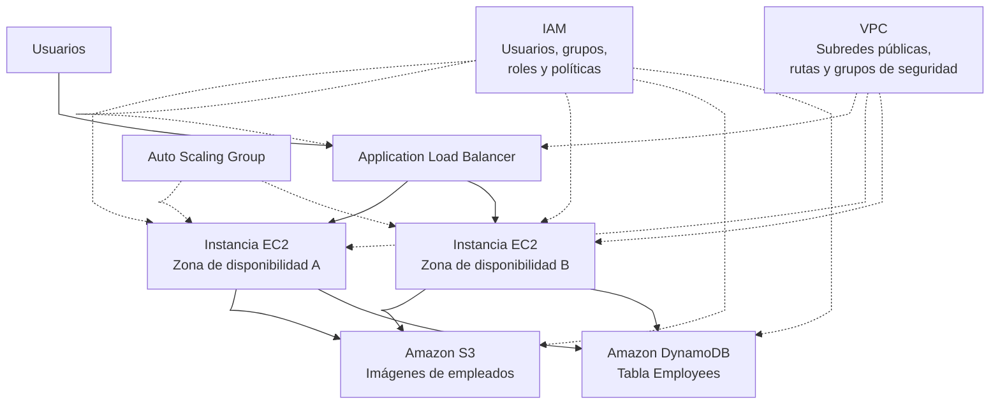

# Módulo 0: Descripción general del curso

<!-- markdownlint-disable MD033 -->

  
  

<!-- markdownlint-enable MD033 -->

## Mapa del curso

**AWS Technical Essentials** contiene 4 laboratorios progresivos. En conjunto presentan los fundamentos de identidad, redes, cómputo, almacenamiento, bases de datos, balanceo de carga y escalado automático.

La progresión general es:

1. Controlar el acceso mediante IAM.
2. Crear la red y desplegar una aplicación en EC2.
3. Integrar la aplicación con S3 y DynamoDB
4. Convertir la aplicación en una arquitectura de alta disponibilidad y escalable.

## [Lab 1: Introduction to AWS Identity and Access Management](labs/01-introduccion-a-aws-identity-and-access-management.md)

Este laboratorio introduce IAM mediante un escenario de empleados con diferentes responsabilidades.

### Objetivos del laboratorio 1

- Explorar usuarios, grupos y políticas IAM.
- Examinar las políticas asociadas a los grupos.
- Añadir usuarios a grupos.
- Comprender cómo se heredan permisos desde los grupos.
- Localizar la URL de inicio de sesión de usuarios IAM.
- Probar permisos diferentes sobre S3 y EC2.

### Recursos utilizados del laboratorio 1

- Tres usuarios IAM:
  - `user-1`
  - `user-2`
  - `user-3`
- Tres grupos IAM:
  - `S3-Support`
  - `EC2-Support`
  - `EC2-Admin`
- Amazon S3.
- Amazon EC2.
- Políticas administradas y una política inline.
- Una instancia EC2 previamente disponible.

### Escenario de permisos del laboratorio 1

|Usuario|Grupo|Permisos|
|---|---|---|
|`user-1`|`S3-Support`|Acceso de solo lectura a S3|
|`user-2`|`EC2-Support`|Acceso de solo lectura a EC2|
|`user-3`|`EC2-Admin`|Consultar, iniciar y detener instancias EC2|

### Flujo principal del laboratorio 1

1. [Explorar los usuarios y grupos IAM.](labs/01-introduccion-a-aws-identity-and-access-management.md#31-crear-user-1)
2. [Revisar las políticas `AmazonS3ReadOnlyAccess` y `AmazonEC2ReadOnlyAccess`.](labs/01-introduccion-a-aws-identity-and-access-management.md#51-crear-la-politica-de-lectura-de-s3)
3. [Revisar la política inline del grupo `EC2-Admin`.](labs/01-introduccion-a-aws-identity-and-access-management.md#55-crear-la-politica-inline-de-administracion-de-ec2)
4. [Añadir cada usuario a su grupo correspondiente.](labs/01-introduccion-a-aws-identity-and-access-management.md#61-asociar-user-1-a-s3-support)
5. [Comprobar qué servicios puede consultar cada uno.](labs/01-introduccion-a-aws-identity-and-access-management.md#74-configurar-perfiles-aws-cli)
6. Verificar que:
    - [`user-1` puede consultar S3, pero no EC2.](labs/01-introduccion-a-aws-identity-and-access-management.md#83-probar-user-1)
    - [`user-2` puede consultar EC2, pero no modificar instancias.](labs/01-introduccion-a-aws-identity-and-access-management.md#84-probar-user-2)
    - [`user-3` puede detener una instancia EC2.](labs/01-introduccion-a-aws-identity-and-access-management.md#85-probar-user-3)

Este laboratorio se centra principalmente en IAM y en la evaluación de permisos.

## Lab 2: Creating a VPC and Launching a Web Application in an EC2 Instance

Este laboratorio crea la infraestructura de red necesaria para alojar una aplicación web en EC2.

### Objetivos del laboratorio 2

- Crear una VPC.
- Crear dos subredes públicas.
- Crear y asociar un Internet Gateway.
- Crear una tabla de rutas pública.
- Crear un grupo de seguridad.
- Lanzar una instancia EC2.
- Configurar una aplicación web mediante User Data.
- Comprobar el acceso a la aplicación desde un navegador.

### Recursos utilizados del laboratorio 2

- Amazon VPC.
- Dos subredes públicas en distintas zonas de disponibilidad.
- Internet Gateway.
- Tabla de rutas.
- Grupo de seguridad.
- Amazon EC2.
- Una AMI de Amazon Linux 2023.
- Una instancia `t3.micro`.
- User Data.
- Node.js.
- Una aplicación web descargada desde Amazon S3.

### Flujo principal del laboratorio 2

1. Crear una VPC con CIDR `10.0.0.0/16`.
2. Crear dos subredes públicas:
    - `10.0.0.0/24`
    - `10.0.1.0/24`
3. Crear un Internet Gateway.
4. Crear una tabla de rutas con una ruta hacia Internet.
5. Asociar las subredes a la tabla de rutas.
6. Crear un grupo de seguridad para permitir tráfico HTTP.
7. Lanzar una instancia EC2.
8. Asignarle una IP pública.
9. Introducir un script de User Data para:
    - actualizar el sistema;
    - instalar NVM;
    - instalar Node.js;
    - descargar la aplicación;
    - instalar sus dependencias;
    - iniciar el servidor web.
10. Acceder a la aplicación mediante la IP pública de la instancia.

Este laboratorio muestra cómo se conectan VPC, subredes, rutas, seguridad y EC2.

## Lab 3: Configure a Web Application to use an Amazon S3 Bucket and DynamoDB Table

Este laboratorio amplía la aplicación web del laboratorio anterior para utilizar almacenamiento de objetos y una base de datos NoSQL.

La aplicación es un directorio de empleados que almacena información de empleados e imágenes.

### Objetivos del laboratorio 3

- Crear un bucket S3.
- Crear una política para el bucket.
- Subir objetos a S3.
- Configurar la aplicación para usar imágenes almacenadas en S3.
- Crear una tabla DynamoDB.
- Probar la aplicación desde su interfaz web.
- Gestionar elementos de DynamoDB desde la consola.
- Crear elementos directamente en DynamoDB.

### Recursos utilizados del laboratorio 3

- Amazon S3.
- Una política de bucket S3.
- Imágenes de empleados.
- Amazon DynamoDB.
- Una tabla llamada `Employees`.
- La aplicación web desplegada en EC2.

### Flujo principal del laboratorio 3

1. Crear un bucket S3 con un nombre único.
2. Mantener activado el bloqueo de acceso público.
3. Crear una política de bucket.
4. Configurar la aplicación para obtener las imágenes desde S3.
5. Subir imágenes al bucket.
6. Eliminar temporalmente una imagen y comprobar su efecto en la aplicación.
7. Crear la tabla DynamoDB `Employees`.
8. Configurar como clave de partición el atributo `id`, de tipo String.
9. Acceder a la aplicación web.
10. Crear empleados desde la interfaz de la aplicación.
11. Comprobar que los registros se almacenan en DynamoDB.
12. Explorar y editar elementos desde la consola DynamoDB.
13. Crear nuevos elementos directamente desde la consola.
14. Volver a la aplicación y verificar los cambios.

Los atributos principales de los empleados son:

- `id`
- `name`
- `location`
- `email`
- `photo`

Este laboratorio demuestra cómo una aplicación puede utilizar EC2 como cómputo, S3 para imágenes y DynamoDB para datos estructurados.

## Lab 4: Configure High Availability for Your Application

Este laboratorio mejora la arquitectura anterior para proporcionar alta disponibilidad y escalado horizontal.

### Objetivos del laboratorio 4

- Revisar la instancia EC2 y la aplicación existente.
- Crear un Application Load Balancer.
- Crear un grupo de destino.
- Crear una plantilla de lanzamiento.
- Crear un Auto Scaling Group.
- Distribuir instancias entre zonas de disponibilidad.
- Probar el balanceo de carga.
- Provocar una situación de carga para observar el escalado automático.

### Recursos utilizados del laboratorio 4

- Amazon EC2.
- Application Load Balancer.
- Target Group.
- Launch Template.
- Auto Scaling Group.
- Dos zonas de disponibilidad.
- El grupo de seguridad creado anteriormente.
- El rol IAM de la aplicación.
- La aplicación Employee Directory.

### Flujo principal del laboratorio 4

1. Revisar la instancia EC2 y comprobar que la aplicación funciona.
2. Consultar la zona de disponibilidad donde se ejecuta.
3. Crear un Application Load Balancer público.
4. Crear un listener HTTP.
5. Crear un Target Group para las instancias de la aplicación.
6. Configurar las comprobaciones de salud.
7. Crear una Launch Template con:
    - Amazon Linux 2023;
    - tipo `t3.micro`;
    - grupo de seguridad web;
    - rol IAM de la aplicación;
    - User Data para instalar y arrancar la aplicación.
8. Crear un Auto Scaling Group.
9. Asociarlo a las dos subredes públicas.
10. Asociarlo al Target Group del balanceador.
11. Configurar los tamaños mínimo, deseado y máximo del grupo.
12. Acceder a la aplicación mediante el DNS del balanceador.
13. Actualizar varias veces la aplicación y observar cambios de zona de disponibilidad.
14. Ejecutar una prueba de carga.
15. Observar cómo Auto Scaling lanza instancias adicionales y las registra en el Target Group.

Este laboratorio introduce la arquitectura de alta disponibilidad basada en múltiples instancias, balanceo de carga y escalado automático.

## Relación entre los laboratorios

| Laboratorio | Tema principal     | Resultado                                               |
| ----------- | ------------------ | ------------------------------------------------------- |
| Lab 1       | IAM                | Usuarios, grupos y permisos diferenciados               |
| Lab 2       | VPC y EC2          | Aplicación web desplegada en una red pública            |
| Lab 3       | S3 y DynamoDB      | Aplicación integrada con almacenamiento y base de datos |
| Lab 4       | ALB y Auto Scaling | Aplicación balanceada, redundante y escalable           |

## Visión global

Al finalizar el Lab Guide, se ha construido progresivamente una aplicación web con esta arquitectura:

IAM controla qué usuarios y componentes pueden acceder a cada servicio. VPC proporciona la red, EC2 ejecuta la aplicación, S3 almacena imágenes, DynamoDB conserva los datos y el balanceador junto con Auto Scaling proporcionan disponibilidad y capacidad de crecimiento.

!!! info "Acerca de este proyecto"
    - Esta documentación ha sido elaborada de forma independiente por **José Antonio Seguido Doblado** como material de estudio.
    - No constituye documentación oficial de Amazon Web Services (AWS).

!!! warning "Advertencia"
    - Para los laboratorios posteriores en el entorno local, esta guía servirá como referencia funcional.
    - Cada laboratorio se adaptará manteniendo sus objetivos, aunque algunos elementos gestionados de AWS podrán representarse mediante recursos simulados o equivalentes locales.
