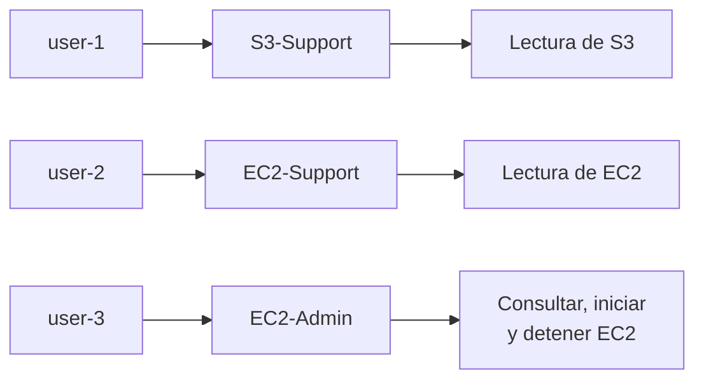
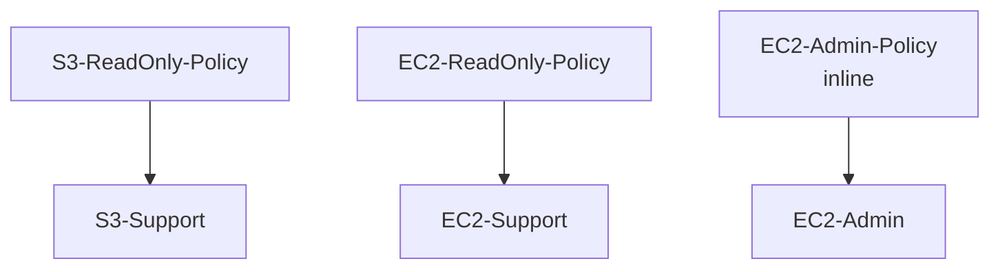
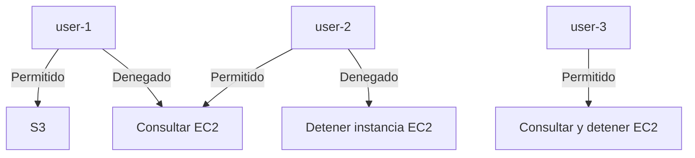

# Lab 1 - Introduction to AWS Identity and Access Management

<!-- markdownlint-disable MD033 -->
<p align="center">
  
  
</p>
<!-- markdownlint-enable MD033 -->

## Objetivos

- Crear usuarios IAM.
- Crear grupos IAM.
- Asociar políticas a grupos.
- Añadir usuarios a grupos.
- Comprender la herencia de permisos.
- Probar permisos diferenciados sobre S3 y EC2.

## Servicios utilizados

| Servicio | Uso en el laboratorio |
| --- | --- |
| **AWS IAM** | Crear usuarios, grupos y políticas; asociar permisos. |
| **Amazon S3** | Probar permisos de lectura para `user-1`. |
| **Amazon EC2** | Probar permisos de lectura y administración para `user-2` y `user-3`. |
| **AWS STS** | Comprobar la identidad asociada a cada perfil mediante `get-caller-identity`. |
| **AWS CLI** | Ejecutar todas las operaciones contra Floci. |

En Floci, todos estos servicios funcionan localmente a través del endpoint:

[http://localhost:4566](http://localhost:4566)

El núcleo del laboratorio es IAM. S3 y EC2 se utilizan para demostrar cómo las políticas permiten o deniegan operaciones según el usuario. STS se utiliza para validar qué identidad está utilizando cada perfil.

## Requisitos del entorno local

Para realizar este laboratorio se deben haber ejecutado los pasos previos de la [configuración inicial.](../../configuracion-floci.md)

## Preparación del simulador

El laboratorio original utiliza la consola de AWS y usuarios IAM reales. En esta adaptación se utilizará Floci como entorno local y AWS CLI como herramienta principal.

La distribución de permisos será:

|Usuario|Grupo|Permisos|
|---|---|---|
|`user-1`|`S3-Support`|Lectura de S3|
|`user-2`|`EC2-Support`|Lectura de EC2|
|`user-3`|`EC2-Admin`|Consultar, iniciar y detener EC2|



Para este laboratorio se utilizarán credenciales ficticias:

```text
AWS_ACCESS_KEY_ID=test
AWS_SECRET_ACCESS_KEY=test
```

Estas credenciales no pertenecen a una cuenta AWS real.

!!! warning
    No utilizar `aws login` para este laboratorio. Ese comando inicia un proceso de autenticación contra AWS real.

### Fase 1 - Verificar el endpoint local

Comprobar que Floci responde mediante STS:

```shell title="Verificar endpoint local"
AWS_ACCESS_KEY_ID=test \
AWS_SECRET_ACCESS_KEY=test \
aws --endpoint-url=http://localhost:4566 \
sts get-caller-identity
```

Resultado obtenido:

```json title="Resultado obtenido"
{
    "UserId": "000000000000",
    "Account": "000000000000",
    "Arn": "arn:aws:iam::000000000000:root"
}
```

La cuenta `000000000000` es la cuenta simulada por Floci.

### Fase 2 - Verificar IAM antes de comenzar

!!! warning "Atención"
    Este laboratorio en particular requiere la activación de Policy Enforcement en Floci siguiendo los siguientes [pasos](../../configuracion-inicial.md#activar-iam-policy-enforcement-en-floci).

Consultar los usuarios existentes:

```shell title="Consultar usuarios existentes"
AWS_ACCESS_KEY_ID=test \
AWS_SECRET_ACCESS_KEY=test \
aws --endpoint-url=http://localhost:4566 \
iam list-users
```

Resultado esperado al comenzar:

```json title="Resultado esperado"
{
    "Users": []
}
```

Esto confirma que no había usuarios IAM creados previamente en el entorno local.

### Fase 3 - Crear usuarios IAM

El laboratorio utiliza tres usuarios con diferentes responsabilidades.

#### 3.1. Crear `user-1`

```shell title="Crear user-1"
AWS_ACCESS_KEY_ID=test \
AWS_SECRET_ACCESS_KEY=test \
aws --endpoint-url=http://localhost:4566 \
iam create-user --user-name user-1
```

Resultado esperado:

```json title="Resultado esperado"
{
    "User": {
        "Path": "/",
        "UserName": "user-1",
        "UserId": "AIDA...",
        "Arn": "arn:aws:iam::000000000000:user/user-1",
        "CreateDate": "..."
    }
}
```

#### 3.2. Crear `user-2`

```shell title="Crear user-2"
AWS_ACCESS_KEY_ID=test \
AWS_SECRET_ACCESS_KEY=test \
aws --endpoint-url=http://localhost:4566 \
iam create-user --user-name user-2
```

#### 3.3. Crear `user-3`

```shell title="Crear user-3"
AWS_ACCESS_KEY_ID=test \
AWS_SECRET_ACCESS_KEY=test \
aws --endpoint-url=http://localhost:4566 \
iam create-user --user-name user-3
```

Los identificadores y las fechas son generados por Floci y pueden variar.

Usuarios creados:

|Usuario|Función|
|---|---|
|`user-1`|Soporte de S3|
|`user-2`|Soporte de EC2|
|`user-3`|Administración de EC2|

Comprobar la lista:

```shell title="Comprobar lista usuarios creados"
AWS_ACCESS_KEY_ID=test \
AWS_SECRET_ACCESS_KEY=test \
aws --endpoint-url=http://localhost:4566 \
iam list-users
```

### Fase 4 - Crear grupos IAM

Los grupos permiten organizar los permisos según la función de cada usuario.

#### 4.1. Crear `S3-Support`

```shell title="Crear S3-Support"
AWS_ACCESS_KEY_ID=test \
AWS_SECRET_ACCESS_KEY=test \
aws --endpoint-url=http://localhost:4566 \
iam create-group --group-name S3-Support
```

#### 4.2. Crear `EC2-Support`

```shell title="Crear EC2-Support"
AWS_ACCESS_KEY_ID=test \
AWS_SECRET_ACCESS_KEY=test \
aws --endpoint-url=http://localhost:4566 \
iam create-group --group-name EC2-Support
```

#### 4.3. Crear `EC2-Admin`

```shell title="Crear EC2-Admin"
AWS_ACCESS_KEY_ID=test \
AWS_SECRET_ACCESS_KEY=test \
aws --endpoint-url=http://localhost:4566 \
iam create-group --group-name EC2-Admin
```

Resultado esperado para cada grupo:

```json title="Resultado esperado"
{
    "Group": {
        "Path": "/",
        "GroupName": "S3-Support",
        "GroupId": "AGPA...",
        "Arn": "arn:aws:iam::000000000000:group/S3-Support",
        "CreateDate": "..."
    }
}
```

Los identificadores y las fechas pueden variar.

Comprobar los grupos creados:

```shell title="Comprobar lista grupos creados"
AWS_ACCESS_KEY_ID=test \
AWS_SECRET_ACCESS_KEY=test \
aws --endpoint-url=http://localhost:4566 \
iam list-groups
```

### Fase 5 - Crear y asociar políticas IAM

En el laboratorio original se utilizan:

- una política administrada de solo lectura para S3;
- una política administrada de solo lectura para EC2;
- una política inline para administrar instancias EC2.

En Floci se crearán políticas locales equivalentes.



#### 5.1. Crear la política de lectura de S3

Crear el archivo:

```shell title="s3-read-only-policy.json"
nano s3-read-only-policy.json
```

Contenido:

```json title="Contenido s3-read-only-policy.json"
{
  "Version": "2012-10-17",
  "Statement": [
    {
      "Sid": "S3ReadOnly",
      "Effect": "Allow",
      "Action": [
        "s3:Get*",
        "s3:List*"
      ],
      "Resource": "*"
    }
  ]
}
```

Guardar el archivo y crear la política:

```shell title="S3-ReadOnly-Policy"
AWS_ACCESS_KEY_ID=test \
AWS_SECRET_ACCESS_KEY=test \
aws --endpoint-url=http://localhost:4566 \
iam create-policy \
  --policy-name S3-ReadOnly-Policy \
  --policy-document file://s3-read-only-policy.json
```

La respuesta incluirá un ARN similar a:

```shell title="ARN incluido en respuesta"
arn:aws:iam::000000000000:policy/S3-ReadOnly-Policy
```

#### 5.2. Asociar la política de S3 al grupo

```shell title="Asociar S3-ReadOnly-Policy a S3-Support"
AWS_ACCESS_KEY_ID=test \
AWS_SECRET_ACCESS_KEY=test \
aws --endpoint-url=http://localhost:4566 \
iam attach-group-policy \
  --group-name S3-Support \
  --policy-arn arn:aws:iam::000000000000:policy/S3-ReadOnly-Policy
```

La operación no devuelve contenido si se ejecuta correctamente.

#### 5.3. Crear la política de lectura de EC2

Crear el archivo:

```shell title="ec2-read-only-policy.json"
nano ec2-read-only-policy.json
```

Contenido:

```json title="Contenido ec2-read-only-policy.json"
{
  "Version": "2012-10-17",
  "Statement": [
    {
      "Sid": "EC2ReadOnly",
      "Effect": "Allow",
      "Action": [
        "ec2:Describe*"
      ],
      "Resource": "*"
    }
  ]
}
```

Crear la política:

```shell title="EC2-ReadOnly-Policy"
AWS_ACCESS_KEY_ID=test \
AWS_SECRET_ACCESS_KEY=test \
aws --endpoint-url=http://localhost:4566 \
iam create-policy \
  --policy-name EC2-ReadOnly-Policy \
  --policy-document file://ec2-read-only-policy.json
```

#### 5.4. Asociar la política de EC2 al grupo

```shell title="Asociar EC2-ReadOnly-Policy a EC2-Support"
AWS_ACCESS_KEY_ID=test \
AWS_SECRET_ACCESS_KEY=test \
aws --endpoint-url=http://localhost:4566 \
iam attach-group-policy \
  --group-name EC2-Support \
  --policy-arn arn:aws:iam::000000000000:policy/EC2-ReadOnly-Policy
```

#### 5.5. Crear la política inline de administración de EC2

En el laboratorio original, el grupo `EC2-Admin` utiliza una política inline para permitir consultar, iniciar y detener instancias.

Crear el archivo:

```shell title="ec2-admin-policy.json"
nano ec2-admin-policy.json
```

Contenido:

```json title="Contenido ec2-admin-policy.json"
{
  "Version": "2012-10-17",
  "Statement": [
    {
      "Sid": "EC2AdminActions",
      "Effect": "Allow",
      "Action": [
        "ec2:Describe*",
        "ec2:StartInstances",
        "ec2:StopInstances"
      ],
      "Resource": "*"
    }
  ]
}
```

Asociar la política inline al grupo:

```shell title="Asociar EC2-Admin-Policy a EC2-Admin"
AWS_ACCESS_KEY_ID=test \
AWS_SECRET_ACCESS_KEY=test \
aws --endpoint-url=http://localhost:4566 \
iam put-group-policy \
  --group-name EC2-Admin \
  --policy-name EC2-Admin-Policy \
  --policy-document file://ec2-admin-policy.json
```

La operación no devuelve contenido si se ejecuta correctamente.

#### 5.6. Comprobar las políticas administradas

Listar las políticas locales:

```shell title="Listar políticas locales"
AWS_ACCESS_KEY_ID=test \
AWS_SECRET_ACCESS_KEY=test \
aws --endpoint-url=http://localhost:4566 \
iam list-policies --scope Local
```

La respuesta debe incluir:

```shell title="Políticas incluidas en la respuesta"
S3-ReadOnly-Policy
EC2-ReadOnly-Policy
```

#### 5.7. Comprobar las políticas asociadas a los grupos

Comprobar el grupo `S3-Support`:

```shell title="Comprobar políticas asociadas a S3-Support"
AWS_ACCESS_KEY_ID=test \
AWS_SECRET_ACCESS_KEY=test \
aws --endpoint-url=http://localhost:4566 \
iam list-attached-group-policies \
  --group-name S3-Support
```

Comprobar el grupo `EC2-Support`:

```shell title="Comprobar políticas asociadas a EC2-Support"
AWS_ACCESS_KEY_ID=test \
AWS_SECRET_ACCESS_KEY=test \
aws --endpoint-url=http://localhost:4566 \
iam list-attached-group-policies \
  --group-name EC2-Support
```

Comprobar la política inline de `EC2-Admin`:

```shell title="Comprobar política inline EC2-Admin"
AWS_ACCESS_KEY_ID=test \
AWS_SECRET_ACCESS_KEY=test \
aws --endpoint-url=http://localhost:4566 \
iam list-group-policies \
  --group-name EC2-Admin
```

Resultado esperado:

|Grupo|Política|Tipo|
|---|---|---|
|`S3-Support`|`S3-ReadOnly-Policy`|Administrada|
|`EC2-Support`|`EC2-ReadOnly-Policy`|Administrada|
|`EC2-Admin`|`EC2-Admin-Policy`|Inline|

Se han creado las políticas necesarias para reproducir el modelo de permisos del laboratorio original:

- `S3-Support` puede leer recursos de S3.
- `EC2-Support` puede consultar recursos de EC2.
- `EC2-Admin` puede consultar, iniciar y detener instancias EC2.

### Fase 6 - Añadir usuarios a los grupos

Asociar cada usuario al grupo correspondiente:

#### 6.1. Asociar `user-1` a `S3-Support`

```shell title="Asociar user-1 a S3-Support"
AWS_ACCESS_KEY_ID=test \
AWS_SECRET_ACCESS_KEY=test \
aws --endpoint-url=http://localhost:4566 \
iam add-user-to-group \
  --user-name user-1 \
  --group-name S3-Support
```

#### 6.2. Asociar `user-2` a `EC2-Support`

```shell title="Asociar user-2 a EC2-Support"
AWS_ACCESS_KEY_ID=test \
AWS_SECRET_ACCESS_KEY=test \
aws --endpoint-url=http://localhost:4566 \
iam add-user-to-group \
  --user-name user-2 \
  --group-name EC2-Support
```

#### 6.3. Asociar `user-3` a `EC2-Admin`

```shell title="Asociar user-3 a EC2-Admin"
AWS_ACCESS_KEY_ID=test \
AWS_SECRET_ACCESS_KEY=test \
aws --endpoint-url=http://localhost:4566 \
iam add-user-to-group \
  --user-name user-3 \
  --group-name EC2-Admin
```

Estas operaciones no devuelven contenido si se ejecutan correctamente.

#### 6.4. Comprobar las asociaciones

```shell title="Comprobar usuarios S3-Support"
AWS_ACCESS_KEY_ID=test \
AWS_SECRET_ACCESS_KEY=test \
aws --endpoint-url=http://localhost:4566 \
iam get-group --group-name S3-Support
```

---

```shell title="Comprobar usuarios EC2-Support"
AWS_ACCESS_KEY_ID=test \
AWS_SECRET_ACCESS_KEY=test \
aws --endpoint-url=http://localhost:4566 \
iam get-group --group-name EC2-Support
```

---

```shell title="Comprobar usuarios EC2-Admin"
AWS_ACCESS_KEY_ID=test \
AWS_SECRET_ACCESS_KEY=test \
aws --endpoint-url=http://localhost:4566 \
iam get-group --group-name EC2-Admin
```

Resultado esperado:

|Grupo|Usuario|
|---|---|
|`S3-Support`|`user-1`|
|`EC2-Support`|`user-2`|
|`EC2-Admin`|`user-3`|

### Fase 7 - Preparar credenciales de los usuarios

Para probar los permisos de cada usuario, necesitamos crear una clave de acceso para cada uno. En Floci sustituirá al inicio de sesión de la consola AWS.

#### 7.1. Crear una clave para `user-1`

```shell title="Crear clave user-1"
AWS_ACCESS_KEY_ID=test \
AWS_SECRET_ACCESS_KEY=test \
aws --endpoint-url=http://localhost:4566 \
iam create-access-key --user-name user-1
```

Guarda los valores:

```json title="Valores clave user-1"
{
    "AccessKey": {
        "UserName": "user-1",
        "AccessKeyId": "...",
        "Status": "Active",
        "SecretAccessKey": "..."
    }
}
```

#### 7.2. Crear una clave para `user-2`

```shell title="Crear clave user-2"
AWS_ACCESS_KEY_ID=test \
AWS_SECRET_ACCESS_KEY=test \
aws --endpoint-url=http://localhost:4566 \
iam create-access-key --user-name user-2
```

Guarda igualmente `AccessKeyId` y `SecretAccessKey`.

### 7.3. Crear una clave para `user-3`

```shell title="Crear clave user-3"
AWS_ACCESS_KEY_ID=test \
AWS_SECRET_ACCESS_KEY=test \
aws --endpoint-url=http://localhost:4566 \
iam create-access-key --user-name user-3
```

### 7.4. Configurar perfiles AWS CLI

Crea un perfil para cada usuario:

```shell title="Crear perfil user-1"
aws configure --profile user-1
```

Introduce la clave y el secreto correspondientes a `user-1`:

```shell title="Configurar perfil user-1"
AWS Access Key ID: <access-key-user-1>
AWS Secret Access Key: <secret-key-user-1>
Default region name: eu-west-1
Default output format: json
```

Repite el proceso:

```shell title="Configurar resto de perfiles"
aws configure --profile user-2
aws configure --profile user-3
```

Cada perfil utilizará las credenciales de su usuario IAM correspondiente.

!!! warning
    Las claves secretas deben guardarse de forma segura. No deben copiarse a repositorios ni compartirse.

### 7.5. Comprobar los perfiles

Consultar la identidad de cada perfil contra Floci:

```shell title="Comprobar identidad user-1"
aws --profile user-1 \
  --endpoint-url=http://localhost:4566 \
  sts get-caller-identity
```

---

```shell title="Comprobar identidad user-2"
aws --profile user-2 \
  --endpoint-url=http://localhost:4566 \
  sts get-caller-identity
```

---

```shell title="Comprobar identidad user-3"
aws --profile user-3 \
  --endpoint-url=http://localhost:4566 \
  sts get-caller-identity
```

El resultado debería identificar a cada usuario mediante un ARN similar a:

```shell title="Resultado"
arn:aws:iam::000000000000:user/user-1
```

### Fase 8 - Crear recursos y probar permisos

En esta fase se crean recursos de prueba con la cuenta administrativa de Floci. Después se prueban las operaciones utilizando los perfiles de los distintos usuarios.

#### 8.1. Crear un bucket S3 de prueba

Crear el bucket con las credenciales administrativas:

```shell title="Crear bucket S3 de prueba"
AWS_ACCESS_KEY_ID=test \
AWS_SECRET_ACCESS_KEY=test \
aws --endpoint-url=http://localhost:4566 \
s3api create-bucket \
  --bucket lab1-employee-data \
  --create-bucket-configuration LocationConstraint=eu-west-1
```

Comprobar que se ha creado:

```shell title="Comprobar bucket de prueba"
AWS_ACCESS_KEY_ID=test \
AWS_SECRET_ACCESS_KEY=test \
aws --endpoint-url=http://localhost:4566 \
s3api list-buckets
```

!!! success "Resultado esperado:"
    `lab1-employee-data`

#### 8.2. Crear una instancia EC2 de prueba

Crear una instancia EC2 simulada:

```shell title="Comprobar instancia EC2 de prueba"
AWS_ACCESS_KEY_ID=test \
AWS_SECRET_ACCESS_KEY=test \
aws --endpoint-url=http://localhost:4566 \
ec2 run-instances \
  --image-id ami-12345678 \
  --instance-type t3.micro
```

Guardar el valor de `InstanceId` que devuelva Floci. Tendrá un formato similar a:

```text
i-e62a20f4c4ca39817
```

También se puede obtener automáticamente:

```shell title="Obtener InstanceId EC2"
INSTANCE_ID=$(
  AWS_ACCESS_KEY_ID=test \
  AWS_SECRET_ACCESS_KEY=test \
  aws --endpoint-url=http://localhost:4566 \
  ec2 describe-instances \
  --query 'Reservations[0].Instances[0].InstanceId' \
  --output text
)

echo "$INSTANCE_ID"
```

Comprobar la instancia:

```shell title="Comprobar instancia"
AWS_ACCESS_KEY_ID=test \
AWS_SECRET_ACCESS_KEY=test \
aws --endpoint-url=http://localhost:4566 \
ec2 describe-instances
```

### 8.3. Probar `user-1`

#### Consultar S3 user-1

```shell title="Consultar bucket S3 user-1"
aws --profile user-1 \
  --endpoint-url=http://localhost:4566 \
  s3 ls
```

!!! success "Resultado esperado:"
    `lab1-employee-data`

`user-1` puede consultar el bucket porque pertenece al grupo `S3-Support`.

#### Consultar EC2 user-1

```shell title="Consultar instancia EC2 user-1"
aws --profile user-1 \
  --endpoint-url=http://localhost:4566 \
  ec2 describe-instances
```

!!! success "Resultado esperado"
    `AccessDenied`

### 8.4. Probar `user-2`

#### Consultar EC2 user-2

```shell title="Consultar instancia EC2 user-2"
aws --profile user-2 \
  --endpoint-url=http://localhost:4566 \
  ec2 describe-instances
```
<!-- markdownlint-disable MD046 -->
!!! success "Resultado esperado:"

    - La operación se ejecuta correctamente.
    - `user-2` puede consultar la instancia.
<!-- markdownlint-enable MD046 -->

#### Intentar detener la instancia

```shell title="Detener instancia EC2 user-2"
aws --profile user-2 \
  --endpoint-url=http://localhost:4566 \
  ec2 stop-instances \
  --instance-ids "$INSTANCE_ID"
```

!!! success "Resultado esperado"
    `AccessDenied`

#### Consultar S3 user-2

```shell title="Consultar bucket S3 user-2"
aws --profile user-2 \
  --endpoint-url=http://localhost:4566 \
  s3api list-buckets
```

!!! success "Resultado esperado"
    `AccessDenied`

### 8.5. Probar `user-3`

#### Consultar EC2 user-3

```shell title="Consultar instancia EC2 user-3"
aws --profile user-3 \
  --endpoint-url=http://localhost:4566 \
  ec2 describe-instances
```

!!! success "Resultado esperado"
    La operación se ejecuta correctamente

#### Detener la instancia

```shell title="Detener instancia EC2 user-3"
aws --profile user-3 \
  --endpoint-url=http://localhost:4566 \
  ec2 stop-instances \
  --instance-ids "$INSTANCE_ID"
```

!!! info "Información"
    El valor de `$INTANCE_ID` es el valor copiado cuando se generó la instancia.

!!! success "Resultado esperado:"
    La instancia cambia a estado `stopping` o equivalente soportado por Floci.
    `user-3` puede detenerla gracias a `EC2-Admin-Policy`.

### 8.6. Verificar el estado final

Comprobar el estado de la instancia con `user-3`:

```shell title="Comprobar estado instancia"
aws --profile user-3 \
  --endpoint-url=http://localhost:4566 \
  ec2 describe-instances \
  --instance-ids "$INSTANCE_ID"
```

La instancia debe aparecer en estado `stopped` o equivalente.

### 8.7. Resultado de las pruebas de permisos

| Usuario  | S3          | Consultar EC2 | Detener EC2 |
| -------- | ----------- | ------------- | ----------- |
| `user-1` | Permitido   | Denegado      | Denegado    |
| `user-2` | Denegado    | Permitido     | Denegado    |
| `user-3` | No definido | Permitido     | Permitido   |

Con IAM Policy Enforcement activado, Floci reproduce correctamente el comportamiento esperado del laboratorio de AWS.



### 8.8. Diferencias respecto al laboratorio real de AWS

La adaptación local mantiene los objetivos del laboratorio, pero presenta estas diferencias:

- Se utiliza Floci en lugar de una cuenta AWS real.
- Los usuarios, grupos y políticas existen en la cuenta simulada `000000000000`.
- Se utilizan perfiles AWS CLI en lugar de iniciar sesión en la consola IAM.
- La instancia EC2 es simulada y no ejecuta realmente un sistema operativo.
- El endpoint es local: `http://localhost:4566`.
- No se utiliza una URL de inicio de sesión IAM pública.
- La evaluación de permisos requiere iniciar Floci con:

    ```yaml title="Policy Enforcement activo"
    FLOCI_SERVICES_IAM_ENFORCEMENT_ENABLED=true
    ```

- Los recursos no generan costes ni afectan a una cuenta AWS real.

### 8.9. Limpieza de recursos

La limpieza debe ejecutarse con las credenciales administrativas de Floci.

#### Terminar la instancia

```shell title="Terminar la instancia"
AWS_ACCESS_KEY_ID=test \
AWS_SECRET_ACCESS_KEY=test \
aws --endpoint-url=http://localhost:4566 \
ec2 terminate-instances \
  --instance-ids "$INSTANCE_ID"
```

#### Vaciar y eliminar el bucket

```shell title="Vaciar bucket S3"
AWS_ACCESS_KEY_ID=test \
AWS_SECRET_ACCESS_KEY=test \
aws --endpoint-url=http://localhost:4566 \
s3 rm s3://lab1-employee-data --recursive
```

```shell title="Eliminar bucket S3"
AWS_ACCESS_KEY_ID=test \
AWS_SECRET_ACCESS_KEY=test \
aws --endpoint-url=http://localhost:4566 \
s3api delete-bucket \
  --bucket lab1-employee-data
```

#### Eliminar las claves de acceso

Obtener las claves existentes:

```shell title="Obtener claves existentes"
AWS_ACCESS_KEY_ID=test \
AWS_SECRET_ACCESS_KEY=test \
aws --endpoint-url=http://localhost:4566 \
iam list-access-keys --user-name user-1
```

Repetir para `user-2` y `user-3`, y eliminar cada clave:

> [!INFO] Información
> El valor de `<ACCESS_KEY_ID>` se debe sustituir por los conseguidos para cada user en el comando anterior

```shell title="Eliminar clave"
AWS_ACCESS_KEY_ID=test \
AWS_SECRET_ACCESS_KEY=test \
aws --endpoint-url=http://localhost:4566 \
iam delete-access-key \
  --user-name user-1 \
  --access-key-id <ACCESS_KEY_ID>
```

#### Eliminar las políticas

Desasociar primero las políticas administradas:

```shell title="Desasociar S3-ReadOnly-Policy"
AWS_ACCESS_KEY_ID=test \
AWS_SECRET_ACCESS_KEY=test \
aws --endpoint-url=http://localhost:4566 \
iam detach-group-policy \
  --group-name S3-Support \
  --policy-arn arn:aws:iam::000000000000:policy/S3-ReadOnly-Policy
```

```shell title="Desasociar EC2-ReadOnly-Policy"
AWS_ACCESS_KEY_ID=test \
AWS_SECRET_ACCESS_KEY=test \
aws --endpoint-url=http://localhost:4566 \
iam detach-group-policy \
  --group-name EC2-Support \
  --policy-arn arn:aws:iam::000000000000:policy/EC2-ReadOnly-Policy
```

Eliminar la política inline:

```shell title="Eliminar EC2-Admin-Policy"
AWS_ACCESS_KEY_ID=test \
AWS_SECRET_ACCESS_KEY=test \
aws --endpoint-url=http://localhost:4566 \
iam delete-group-policy \
  --group-name EC2-Admin \
  --policy-name EC2-Admin-Policy
```

Eliminar las políticas administradas:

```shell title="Eliminar S3-ReadOnly-Policy"
AWS_ACCESS_KEY_ID=test \
AWS_SECRET_ACCESS_KEY=test \
aws --endpoint-url=http://localhost:4566 \
iam delete-policy \
  --policy-arn arn:aws:iam::000000000000:policy/S3-ReadOnly-Policy
```

```shell title="Eliminar EC2-ReadOnly-Policy"
AWS_ACCESS_KEY_ID=test \
AWS_SECRET_ACCESS_KEY=test \
aws --endpoint-url=http://localhost:4566 \
iam delete-policy \
  --policy-arn arn:aws:iam::000000000000:policy/EC2-ReadOnly-Policy
```

#### Eliminar usuarios de los grupos

```shell title="Eliminar user-1 del grupo S3-Support"
AWS_ACCESS_KEY_ID=test \
AWS_SECRET_ACCESS_KEY=test \
aws --endpoint-url=http://localhost:4566 \
iam remove-user-from-group \
  --user-name user-1 \
  --group-name S3-Support
```

```shell title="Eliminar user-2 del grupo EC2-Support"
AWS_ACCESS_KEY_ID=test \
AWS_SECRET_ACCESS_KEY=test \
aws --endpoint-url=http://localhost:4566 \
iam remove-user-from-group \
  --user-name user-2 \
  --group-name EC2-Support
```

```shell title="Eliminar user-3 del grupo EC2-Admin"
AWS_ACCESS_KEY_ID=test \
AWS_SECRET_ACCESS_KEY=test \
aws --endpoint-url=http://localhost:4566 \
iam remove-user-from-group \
  --user-name user-3 \
  --group-name EC2-Admin
```

#### Eliminar los grupos

```shell title="Eliminar grupo S3-Support"
AWS_ACCESS_KEY_ID=test \
AWS_SECRET_ACCESS_KEY=test \
aws --endpoint-url=http://localhost:4566 \
iam delete-group --group-name S3-Support
```

```shell title="Eliminar grupo EC2-Support"
AWS_ACCESS_KEY_ID=test \
AWS_SECRET_ACCESS_KEY=test \
aws --endpoint-url=http://localhost:4566 \
iam delete-group --group-name EC2-Support
```

```shell title="Eliminar grupo EC2-Admin"
AWS_ACCESS_KEY_ID=test \
AWS_SECRET_ACCESS_KEY=test \
aws --endpoint-url=http://localhost:4566 \
iam delete-group --group-name EC2-Admin
```

#### Eliminar los usuarios

```shell title="Eliminar usuario user-1"
AWS_ACCESS_KEY_ID=test \
AWS_SECRET_ACCESS_KEY=test \
aws --endpoint-url=http://localhost:4566 \
iam delete-user --user-name user-1
```

```shell title="Eliminar usuario user-2"
AWS_ACCESS_KEY_ID=test \
AWS_SECRET_ACCESS_KEY=test \
aws --endpoint-url=http://localhost:4566 \
iam delete-user --user-name user-2
```

```shell title="Eliminar usuario user-3"
AWS_ACCESS_KEY_ID=test \
AWS_SECRET_ACCESS_KEY=test \
aws --endpoint-url=http://localhost:4566 \
iam delete-user --user-name user-3
```

### 8.10. Comprobación de limpieza

```shell title="Comprobar usuarios"
AWS_ACCESS_KEY_ID=test \
AWS_SECRET_ACCESS_KEY=test \
aws --endpoint-url=http://localhost:4566 \
iam list-users
```

```shell title="Comprobar buckets S3"
AWS_ACCESS_KEY_ID=test \
AWS_SECRET_ACCESS_KEY=test \
aws --endpoint-url=http://localhost:4566 \
s3api list-buckets
```

```shell title="Comprobar instancias EC2"
AWS_ACCESS_KEY_ID=test \
AWS_SECRET_ACCESS_KEY=test \
aws --endpoint-url=http://localhost:4566 \
ec2 describe-instances
```

Otra alternativa para ver las instancias sería:

```shell title="Comprobar instancias EC2"
AWS_ACCESS_KEY_ID=test \
AWS_SECRET_ACCESS_KEY=test \
aws --endpoint-url=http://localhost:4566 \
ec2 describe-instances \
  --query 'Reservations[].Instances[].{Id:InstanceId,State:State.Name,Type:InstanceType}' \
  --output table
```

El entorno debería quedar sin usuarios, buckets ni instancias de este laboratorio.

## Conclusión

El laboratorio ha permitido:

- crear usuarios y grupos IAM;
- asociar permisos mediante políticas;
- comprobar permisos heredados;
- crear recursos S3 y EC2;
- probar operaciones permitidas y denegadas;
- validar la evaluación IAM con Floci;
- limpiar los recursos creados.

Con IAM Policy Enforcement activado, Floci permite reproducir funcionalmente el objetivo principal del Lab 1 de AWS Technical Essentials.