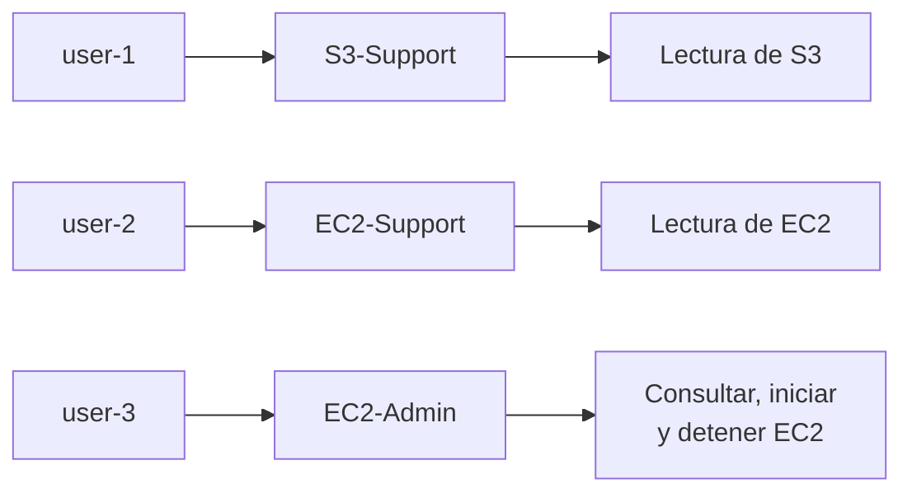
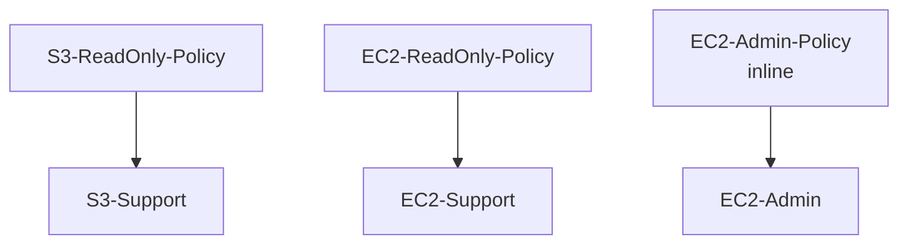

# Lab 1 - Introduction to AWS Identity and Access Management

<!-- markdownlint-disable MD033 -->
<p align="center">
  
  
</p>
<!-- markdownlint-enable MD033 -->

## Objetivos

- Crear usuarios IAM.
- Crear grupos IAM.
- Asociar políticas a grupos.
- Añadir usuarios a grupos.
- Comprender la herencia de permisos.
- Probar permisos diferenciados sobre S3 y EC2.

## Adaptación a Floci

El laboratorio original utiliza la consola de AWS y usuarios IAM reales. En esta adaptación se utilizará Floci como entorno local y AWS CLI como herramienta principal.

La distribución de permisos será:

|Usuario|Grupo|Permisos|
|---|---|---|
|`user-1`|`S3-Support`|Lectura de S3|
|`user-2`|`EC2-Support`|Lectura de EC2|
|`user-3`|`EC2-Admin`|Consultar, iniciar y detener EC2|



Para este laboratorio se utilizarán credenciales ficticias:

```shell
AWS_ACCESS_KEY_ID=test
AWS_SECRET_ACCESS_KEY=test
```

Estas credenciales no pertenecen a una cuenta AWS real.

!!! warning
    No utilizar `aws login` para este laboratorio. Ese comando inicia un proceso de autenticación contra AWS real.

### Fase 1 - Verificar el endpoint local

Comprobar que Floci responde mediante STS:

```shell
AWS_ACCESS_KEY_ID=test \
AWS_SECRET_ACCESS_KEY=test \
aws --endpoint-url=http://localhost:4566 \
sts get-caller-identity
```

Resultado obtenido:

```json
{
    "UserId": "000000000000",
    "Account": "000000000000",
    "Arn": "arn:aws:iam::000000000000:root"
}
```

La cuenta `000000000000` es la cuenta simulada por Floci.

### Fase 2 - Verificar IAM antes de comenzar

Consultar los usuarios existentes:

```shell
AWS_ACCESS_KEY_ID=test \
AWS_SECRET_ACCESS_KEY=test \
aws --endpoint-url=http://localhost:4566 \
iam list-users
```

Resultado esperado al comenzar:

```json
{
    "Users": []
}
```

Esto confirma que no había usuarios IAM creados previamente en el entorno local.

### Fase 3 - Crear usuarios IAM

El laboratorio utiliza tres usuarios con diferentes responsabilidades.

#### 3.1. Crear `user-1`

```shell
AWS_ACCESS_KEY_ID=test \
AWS_SECRET_ACCESS_KEY=test \
aws --endpoint-url=http://localhost:4566 \
iam create-user --user-name user-1
```

Resultado esperado:

```json
{
    "User": {
        "Path": "/",
        "UserName": "user-1",
        "UserId": "AIDA...",
        "Arn": "arn:aws:iam::000000000000:user/user-1",
        "CreateDate": "..."
    }
}
```

#### 3.2. Crear `user-2`

```shell
AWS_ACCESS_KEY_ID=test \
AWS_SECRET_ACCESS_KEY=test \
aws --endpoint-url=http://localhost:4566 \
iam create-user --user-name user-2
```

#### 3.3. Crear `user-3`

```shell
AWS_ACCESS_KEY_ID=test \
AWS_SECRET_ACCESS_KEY=test \
aws --endpoint-url=http://localhost:4566 \
iam create-user --user-name user-3
```

Los identificadores y las fechas son generados por Floci y pueden variar.

Usuarios creados:

|Usuario|Función|
|---|---|
|`user-1`|Soporte de S3|
|`user-2`|Soporte de EC2|
|`user-3`|Administración de EC2|

Comprobar la lista:

```shell
AWS_ACCESS_KEY_ID=test \
AWS_SECRET_ACCESS_KEY=test \
aws --endpoint-url=http://localhost:4566 \
iam list-users
```

### Fase 4 - Crear grupos IAM

Los grupos permiten organizar los permisos según la función de cada usuario.

#### 4.1. Crear `S3-Support`

```shell
AWS_ACCESS_KEY_ID=test \
AWS_SECRET_ACCESS_KEY=test \
aws --endpoint-url=http://localhost:4566 \
iam create-group --group-name S3-Support
```

#### 4.2. Crear `EC2-Support`

```shell
AWS_ACCESS_KEY_ID=test \
AWS_SECRET_ACCESS_KEY=test \
aws --endpoint-url=http://localhost:4566 \
iam create-group --group-name EC2-Support
```

#### 4.3. Crear `EC2-Admin`

```shell
AWS_ACCESS_KEY_ID=test \
AWS_SECRET_ACCESS_KEY=test \
aws --endpoint-url=http://localhost:4566 \
iam create-group --group-name EC2-Admin
```

Resultado esperado para cada grupo:

```json
{
    "Group": {
        "Path": "/",
        "GroupName": "S3-Support",
        "GroupId": "AGPA...",
        "Arn": "arn:aws:iam::000000000000:group/S3-Support",
        "CreateDate": "..."
    }
}
```

Los identificadores y las fechas pueden variar.

Comprobar los grupos creados:

```shell
AWS_ACCESS_KEY_ID=test \
AWS_SECRET_ACCESS_KEY=test \
aws --endpoint-url=http://localhost:4566 \
iam list-groups
```

### Fase 5 - Crear y asociar políticas IAM

En el laboratorio original se utilizan:

- una política administrada de solo lectura para S3;
- una política administrada de solo lectura para EC2;
- una política inline para administrar instancias EC2.

En Floci se crearán políticas locales equivalentes.



#### 5.1. Crear la política de lectura de S3

Crear el archivo:

```shell
nano s3-read-only-policy.json
```

Contenido:

```json
{
  "Version": "2012-10-17",
  "Statement": [
    {
      "Sid": "S3ReadOnly",
      "Effect": "Allow",
      "Action": [
        "s3:Get*",
        "s3:List*"
      ],
      "Resource": "*"
    }
  ]
}
```

Guardar el archivo y crear la política:

```shell
AWS_ACCESS_KEY_ID=test \
AWS_SECRET_ACCESS_KEY=test \
aws --endpoint-url=http://localhost:4566 \
iam create-policy \
  --policy-name S3-ReadOnly-Policy \
  --policy-document file://s3-read-only-policy.json
```

La respuesta incluirá un ARN similar a:

```shell
arn:aws:iam::000000000000:policy/S3-ReadOnly-Policy
```

#### 5.2. Asociar la política de S3 al grupo

```shell
AWS_ACCESS_KEY_ID=test \
AWS_SECRET_ACCESS_KEY=test \
aws --endpoint-url=http://localhost:4566 \
iam attach-group-policy \
  --group-name S3-Support \
  --policy-arn arn:aws:iam::000000000000:policy/S3-ReadOnly-Policy
```

La operación no devuelve contenido si se ejecuta correctamente.

#### 5.3. Crear la política de lectura de EC2

Crear el archivo:

```shell
nano ec2-read-only-policy.json
```

Contenido:

```json
{
  "Version": "2012-10-17",
  "Statement": [
    {
      "Sid": "EC2ReadOnly",
      "Effect": "Allow",
      "Action": [
        "ec2:Describe*"
      ],
      "Resource": "*"
    }
  ]
}
```

Crear la política:

```shell
AWS_ACCESS_KEY_ID=test \
AWS_SECRET_ACCESS_KEY=test \
aws --endpoint-url=http://localhost:4566 \
iam create-policy \
  --policy-name EC2-ReadOnly-Policy \
  --policy-document file://ec2-read-only-policy.json
```

#### 5.4. Asociar la política de EC2 al grupo

```shell
AWS_ACCESS_KEY_ID=test \
AWS_SECRET_ACCESS_KEY=test \
aws --endpoint-url=http://localhost:4566 \
iam attach-group-policy \
  --group-name EC2-Support \
  --policy-arn arn:aws:iam::000000000000:policy/EC2-ReadOnly-Policy
```

#### 5.5. Crear la política inline de administración de EC2

En el laboratorio original, el grupo `EC2-Admin` utiliza una política inline para permitir consultar, iniciar y detener instancias.

Crear el archivo:

```shell
nano ec2-admin-policy.json
```

Contenido:

```json
{
  "Version": "2012-10-17",
  "Statement": [
    {
      "Sid": "EC2AdminActions",
      "Effect": "Allow",
      "Action": [
        "ec2:Describe*",
        "ec2:StartInstances",
        "ec2:StopInstances"
      ],
      "Resource": "*"
    }
  ]
}
```

Asociar la política inline al grupo:

```shell
AWS_ACCESS_KEY_ID=test \
AWS_SECRET_ACCESS_KEY=test \
aws --endpoint-url=http://localhost:4566 \
iam put-group-policy \
  --group-name EC2-Admin \
  --policy-name EC2-Admin-Policy \
  --policy-document file://ec2-admin-policy.json
```

La operación no devuelve contenido si se ejecuta correctamente.

#### 5.6. Comprobar las políticas administradas

Listar las políticas locales:

```shell
AWS_ACCESS_KEY_ID=test \
AWS_SECRET_ACCESS_KEY=test \
aws --endpoint-url=http://localhost:4566 \
iam list-policies --scope Local
```

La respuesta debe incluir:

```shell
S3-ReadOnly-Policy
EC2-ReadOnly-Policy
```

#### 5.7. Comprobar las políticas asociadas a los grupos

Comprobar el grupo `S3-Support`:

```shell
AWS_ACCESS_KEY_ID=test \
AWS_SECRET_ACCESS_KEY=test \
aws --endpoint-url=http://localhost:4566 \
iam list-attached-group-policies \
  --group-name S3-Support
```

Comprobar el grupo `EC2-Support`:

```shell
AWS_ACCESS_KEY_ID=test \
AWS_SECRET_ACCESS_KEY=test \
aws --endpoint-url=http://localhost:4566 \
iam list-attached-group-policies \
  --group-name EC2-Support
```

Comprobar la política inline de `EC2-Admin`:

```shell
AWS_ACCESS_KEY_ID=test \
AWS_SECRET_ACCESS_KEY=test \
aws --endpoint-url=http://localhost:4566 \
iam list-group-policies \
  --group-name EC2-Admin
```

Resultado esperado:

|Grupo|Política|Tipo|
|---|---|---|
|`S3-Support`|`S3-ReadOnly-Policy`|Administrada|
|`EC2-Support`|`EC2-ReadOnly-Policy`|Administrada|
|`EC2-Admin`|`EC2-Admin-Policy`|Inline|

Se han creado las políticas necesarias para reproducir el modelo de permisos del laboratorio original:

- `S3-Support` puede leer recursos de S3.
- `EC2-Support` puede consultar recursos de EC2.
- `EC2-Admin` puede consultar, iniciar y detener instancias EC2.

### Fase 6 - Añadir usuarios a los grupos

Asociar cada usuario al grupo correspondiente:

#### 6.1. Asociar `user-1` a `S3-Support`

```shell
AWS_ACCESS_KEY_ID=test \
AWS_SECRET_ACCESS_KEY=test \
aws --endpoint-url=http://localhost:4566 \
iam add-user-to-group \
  --user-name user-1 \
  --group-name S3-Support
```

#### 6.2. Asociar `user-2` a `EC2-Support`

```shell
AWS_ACCESS_KEY_ID=test \
AWS_SECRET_ACCESS_KEY=test \
aws --endpoint-url=http://localhost:4566 \
iam add-user-to-group \
  --user-name user-2 \
  --group-name EC2-Support
```

#### 6.3. Asociar `user-3` a `EC2-Admin`

```shell
AWS_ACCESS_KEY_ID=test \
AWS_SECRET_ACCESS_KEY=test \
aws --endpoint-url=http://localhost:4566 \
iam add-user-to-group \
  --user-name user-3 \
  --group-name EC2-Admin
```

Estas operaciones no devuelven contenido si se ejecutan correctamente.

#### 6.4. Comprobar las asociaciones

```shell
AWS_ACCESS_KEY_ID=test \
AWS_SECRET_ACCESS_KEY=test \
aws --endpoint-url=http://localhost:4566 \
iam get-group --group-name S3-Support
```

---

```shell
AWS_ACCESS_KEY_ID=test \
AWS_SECRET_ACCESS_KEY=test \
aws --endpoint-url=http://localhost:4566 \
iam get-group --group-name EC2-Support
```

---

```shell
AWS_ACCESS_KEY_ID=test \
AWS_SECRET_ACCESS_KEY=test \
aws --endpoint-url=http://localhost:4566 \
iam get-group --group-name EC2-Admin
```

Resultado esperado:

|Grupo|Usuario|
|---|---|
|`S3-Support`|`user-1`|
|`EC2-Support`|`user-2`|
|`EC2-Admin`|`user-3`|

### Fase 7 - Preparar credenciales de los usuarios

Para probar los permisos de cada usuario, necesitamos crear una clave de acceso para cada uno. En Floci sustituirá al inicio de sesión de la consola AWS.

#### 7.1. Crear una clave para `user-1`

```shell
AWS_ACCESS_KEY_ID=test \
AWS_SECRET_ACCESS_KEY=test \
aws --endpoint-url=http://localhost:4566 \
iam create-access-key --user-name user-1
```

Guarda los valores:

```json
{
    "AccessKey": {
        "UserName": "user-1",
        "AccessKeyId": "...",
        "Status": "Active",
        "SecretAccessKey": "..."
    }
}
```

#### 7.2. Crear una clave para `user-2`

```shell
AWS_ACCESS_KEY_ID=test \
AWS_SECRET_ACCESS_KEY=test \
aws --endpoint-url=http://localhost:4566 \
iam create-access-key --user-name user-2
```

Guarda igualmente `AccessKeyId` y `SecretAccessKey`.

### 7.3. Crear una clave para `user-3`

```shell
AWS_ACCESS_KEY_ID=test \
AWS_SECRET_ACCESS_KEY=test \
aws --endpoint-url=http://localhost:4566 \
iam create-access-key --user-name user-3
```

### 7.4. Configurar perfiles AWS CLI

Crea un perfil para cada usuario:

```shell
AWS_ACCESS_KEY_ID=test \
AWS_SECRET_ACCESS_KEY=test \
aws --endpoint-url=http://localhost:4566 \
aws configure --profile user-1
```

Introduce la clave y el secreto correspondientes a `user-1`:

```shell
AWS Access Key ID: <access-key-user-1>
AWS Secret Access Key: <secret-key-user-1>
Default region name: eu-west-1
Default output format: json
```

Repite el proceso:

```shell
aws configure --profile user-2
aws configure --profile user-3
```

Cada perfil utilizará las credenciales de su usuario IAM correspondiente.

!!! warning
    Las claves secretas deben guardarse de forma segura. No deben copiarse a repositorios ni compartirse.

### 7.5. Comprobar los perfiles

Consultar la identidad de cada perfil contra Floci:

```shell
aws --profile user-1 \
  --endpoint-url=http://localhost:4566 \
  sts get-caller-identity
```

```shell
aws --profile user-2 \
  --endpoint-url=http://localhost:4566 \
  sts get-caller-identity
```

```shell
aws --profile user-3 \
  --endpoint-url=http://localhost:4566 \
  sts get-caller-identity
```

El resultado debería identificar a cada usuario mediante un ARN similar a:

```shell
arn:aws:iam::000000000000:user/user-1
```
